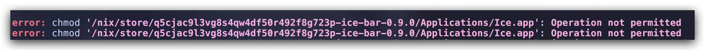
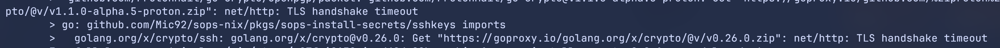

<h3 align="center">
  <br/>
  
   NixOS Config for <a href="https://github.com/shelken">Shelken</a>
  
</h3>

<h6 align="center">
  <a href="#结构">结构</a>
  ·
  <a href="#darwin">Darwin</a>
  ·
  <a href="#部署">部署</a>
  ·
  <a href="docs/user-guide/README.md">用户指南</a>
  ·
  <a href="#引用">引用</a>
</h6>

<p align="center">
  
</p>

<p align="center">
  <a href="https://nixos.org/"></a>
  <a href="https://github.com/shelken/nix-config"></a>
  <a href="https://github.com/shelken/nix-config/commits"></a>
</p>

&nbsp;

# 结构

按功能组织配置，同一软件的 nix-darwin、NixOS 与 Home Manager 声明写在同一处；主机只选一个主角色与按需附加角色，功能自行声明归属

加软件、启用可选功能与新增主机的步骤见 [功能与角色](docs/user-guide/02-features.md)，设计原因见 [ADR 0004](docs/adr/0004-dendritic-feature-modules.md)

# darwin


## 初始化

```bash
# 0. 启用 secrets 时，将新机器公钥加入 secrets.nix，并在 hosts/<host>/default.nix 设 shelken.secrets.enable = true
ssh-keygen -t ed25519 -C "shelken@[host]"
cat ~/.ssh/id_ed25519.pub   # 公钥添加到 GitHub

# 1. 安装 Homebrew
/bin/bash -c "$(curl -fsSL https://raw.githubusercontent.com/Homebrew/install/HEAD/install.sh)"
eval "$(/opt/homebrew/bin/brew shellenv)"

# 2. 安装 Nix（macOS 用 Determinate Nix，配置见 modules/features/nix/nix-settings.nix）
curl --proto '=https' --tlsv1.2 -sSf -L https://install.determinate.systems/nix \
  | sh -s -- install --determinate

# 3. 克隆仓库
git clone https://github.com/shelken/nix-config.git ~/nix-config && cd ~/nix-config

# 4. 选择 hosts/default.nix 中登记的机器名
PROFILE=mio
printf 'PROFILE=%s\n' "$PROFILE" > .host-profile

# 5. 首次应用（守护进程异常可重启 systems.determinate.nix-daemon）
sudo nix run nix-darwin/master#darwin-rebuild -- switch --flake ".#$PROFILE"

# 6. 打开新 shell 后日常应用
just sw
```

## 日常命令

构建、切换、更新 inputs 的命令见 [快速上手](docs/user-guide/00-quickstart.md)

## 卸载

```bash
sudo darwin-uninstaller
/nix/nix-installer uninstall
```

## 常见问题

- **切换 Homebrew 为官方源**：`git -C "$(brew --repo)" remote set-url origin https://github.com/Homebrew/brew`
- **私有 `secrets` 拉取失败**：私有 `secrets` 走 Git + HTTPS，初始化前确保本机 Git 凭据可用
- **Font 文件提示等待 lock 锁**：`sudo rm -rf /nix/store/**.lock`
- **Homebrew Cask 已安装仍重复安装**：因包更名（如 `squirrel` 改为 `squirrel-app`）导致 `Caskroom` 残留旧目录，清理 `$(brew --prefix)/Caskroom/<旧名>` 后重试
- **手动删除 `/nix/store` 条目后提示 `No such file or directory`**：做一次小改动切换新代并 GC 旧代，执行 `nix store delete <缺失路径>`，再撤销改动重新 switch
- **提示 `Operation not permitted`**：在系统设置给 nix 完整磁盘访问权限
  
- **安装 Homebrew 或拉取 Go 模块失败（即使设置了代理）**：尝试使用手机热点配合 Quantumult X 代理
  

# 部署

```bash
just deploy-diff                         # 检查各主机待部署差异
just deploy-all                          # 确认后逐台部署有差异的主机
just deploy <主机>                       # 远程部署单台主机
just linux::gen-image <host> <variant>   # 构建镜像变体（iso / qemu 等）并 rsync 上传到 PVE（覆盖 latest）
```

完整配方见 `just --list`，远程装机与回滚见 [VPS 指南](docs/user-guide/05-vps.md)

# 引用

> 配置参考来源

- [ryan4yin's nix-config](https://github.com/ryan4yin/nix-config) `*`主要配置来源
- [khaneliman/khanelinix](https://github.com/khaneliman/khanelinix) `*`早期参考的 Snowfall 结构
- [mightyiam/dendritic](https://github.com/mightyiam/dendritic) `*`当前按功能组织的 Dendritic 模式
- [flake-parts modules](https://flake.parts/options/flake-parts-modules.html) 与 [import-tree](https://github.com/denful/import-tree)：Dendritic 的实现基础
- [catppuccin/catppuccin](https://github.com/catppuccin/catppuccin) `*`主题配色
- [Web结构化展示nix-darwin,home-manager,nixos等所有的选项](https://mynixos.com/flakes)
- [Home Manager Options](https://home-manager-options.extranix.com)
- [Nix Darwin Configuration Options](https://daiderd.com/nix-darwin/manual/index.html)
- [NixOS Packages Search](https://search.nixos.org/packages)
- [NixOS Options Search](https://search.nixos.org/options)
- [NUR - 社区包搜索](https://nur.nix-community.org)
- [NixOS 与 Flakes 一份非官方的新手指南](https://nixos-and-flakes.thiscute.world/zh) `*`中文教程

# 许可证

[MIT](LICENSE)
