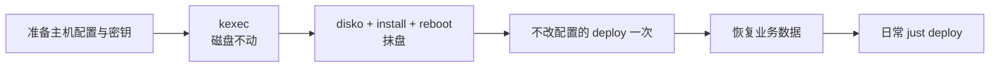

# VPS：接管与部署

把一台装着任意 Linux 的 VPS 换成本仓库管理的 NixOS，之后在 Mac 上一条命令推送更新。目前只有 vps-cc 一台，它的切换实录与核对清单见 `hosts/vps/vps-cc/README.md`

## 三个工具

| 工具           | 做什么                                                                  | 什么时候用             |
| -------------- | ----------------------------------------------------------------------- | ---------------------- |
| nixos-anywhere | 通过 SSH 把目标机 kexec 进内存里的安装环境，再分区、安装、重启          | 装机时一次             |
| disko          | 用 Nix 声明分区与文件系统，nixos-anywhere 装机时按它抹盘                | 装机时，由上面那步调用 |
| deploy-rs      | 在 Mac 上构建系统，推到 VPS 激活；新 SSH 连接 30 秒内确认不了就自动回滚 | 装好之后的每次更新     |



x86_64 的系统在 Mac 上构建，靠 `linux-builder`，装机和部署前它必须在运行

它的启停与重置见 `modules/features/darwin/linux-builder/darwin.nix` 头部注释：`linux-builder status` 看状态，`linux-builder stop` 停机（原终端已关闭也能停），guest 磁盘是只涨不缩的稀疏文件，`just builder-reset` 会删掉它，下次启动是空 store（VM 必须在已停机状态下执行）

## 一台 VPS 由哪些文件组成

| 位置                                            | 内容                                                                              |
| ----------------------------------------------- | --------------------------------------------------------------------------------- |
| `hosts/vps/common.nix`                          | VPS 共有：`server` 角色、磁盘、sshd 端口、防火墙、tailscale、docker、口令哈希     |
| `hosts/vps/<主机>/default.nix`                  | 主机自己的：主机名、静态网络、网卡级 sysctl                                       |
| `flake.nix` 的 `hosts.<主机>`                   | 注册主机，`deploy` 写成属性集即成为部署目标                                       |
| `secrets` 仓库 `hosts/<主机>/network.nix`       | 服务商分配的地址，明文，求值时读取                                                |
| `secrets` 仓库 `sops/secrets/hosts/<主机>.yaml` | 口令哈希，只加密给管理员与这台主机的 age 公钥                                     |
| `~/.ssh/specific`                               | 与主机同名的 SSH 别名（地址、端口），deploy-rs 按主机名连接，公网地址不进公开仓库 |

为什么网络参数是明文、口令走 sops、age 密钥不从 SSH 主机密钥派生，见 `docs/adr/0005-server-role-and-core-baseline.md`

## 加一台新 VPS

### 1. 看清目标机

在旧系统里记下这几项，后面都要用

```bash
ls /sys/firmware/efi        # 存在是 uefi，不存在是 bios
lsblk -o NAME,SIZE,TYPE     # 系统盘，virtio 一般是 /dev/vda
ip -br a; ip r; ip -6 r     # 网卡名、地址、前缀、网关
ip link show <网卡>         # MTU
```

### 2. 在 secrets 仓库准备两样东西

- 网络参数 `hosts/<主机>/network.nix`
  ```nix
  {
    interface = "eth0";
    mtu = 1400;
    ipv4 = { address = "<IPv4>"; prefixLength = 24; gateway = "<网关>"; };
    ipv6 = { addresses = [ "<IPv6>" ]; prefixLength = 64; gateway = "<网关>"; };
  }
  ```
- 主机自己的 age 密钥和口令密文
  1. `age-keygen -o <主机>-age.txt` 生成私钥，屏幕上打印的是公钥
  2. `.sops.yaml` 里照 vps-cc 那条规则加一条 `sops/secrets/hosts/<主机>\.yaml$`，接收方是管理员公钥加这台主机的公钥，放在通用规则之前
  3. 新建 `sops/secrets/hosts/<主机>.yaml`，写入 `shelken-password-hash` 与 `root-password-hash` 两个键，值用 `nix shell nixpkgs#mkpasswd -c mkpasswd -m yescrypt` 生成
  4. 提交并推送，回本仓库 `nix flake update secrets`

私钥文件不进任何仓库，装机时用 `--extra-files` 带过去。丢了不要紧：换一把新的，`sops updatekeys` 后重装即可

### 3. 写主机配置

复制 `hosts/vps/vps-cc/` 成 `hosts/vps/<主机>/`，改主机名与 `network.nix` 的路径。按第 1 步的结果核对 `common.nix` 里的磁盘设置

| `shelken.disko` | 默认值 | 作用                                                    |
| --------------- | ------ | ------------------------------------------------------- |
| `device`        | 无     | 要抹掉的整块盘，如 `/dev/vda`                           |
| `layout`        | `ext4` | `ext4` 单根分区；`btrfs` 带子卷与 zstd 压缩             |
| `boot`          | `uefi` | `bios` 建 1M EF02 分区并启用 GRUB；`uefi` 建 1G ESP     |
| `swapSize`      | `null` | 仅 `btrfs`：swapfile 大小。`server` 角色已开 `zramSwap` |

`common.nix` 目前按 vps-cc 写：`sops.defaultSopsFile` 指向 `vps-cc.yaml`，sshd 端口、防火墙放行都是 vps-cc 的。加第二台时，把这些挪进各主机自己的 `default.nix`

服务商会发 IPv6 路由通告时，保留 vps-cc 里那段 `accept_ra = 0`、`autoconf = 0`，否则自动地址会抢走 UDP 回包的源地址，原因见 `hosts/vps/vps-cc/default.nix` 的注释

### 4. 注册并构建

`flake.nix` 的 `hosts` 里照抄 `vps-cc` 一条，改名字和目录。`deploy` 用 root 推送，激活不需要输口令

```bash
git add hosts/vps/<主机>
nix build .#nixosConfigurations.<主机>.config.system.build.toplevel
```

在 `~/.ssh/specific` 里加一条与主机同名的 `Host`，写地址与端口。`~/.ssh/config` 由 Nix 生成并 `Include` 这个文件（`modules/features/shell/ssh.nix`），不要直接改

### 5. 先演练（可选，换了固件或架构时强烈建议）

`vps-test` 是 x86_64 BIOS 的 Lima 演练机，与 vps-cc 共用 `common.nix`，完整走一遍约 20 分钟，命令见 `hosts/vps/vps-cc/README.md` 的「演练」一节。演练暴露过的坑与处理见同一节的「演练里遇到的问题」

## 装机

### 准备随装目录

装机抹盘。旧盘上不在 Nix 配置里、开机就要读的文件，放进一个临时目录，目录结构就是目标路径

| 文件                                     | 目标路径                              | 不带会怎样                          |
| ---------------------------------------- | ------------------------------------- | ----------------------------------- |
| 主机 age 私钥                            | `/var/lib/sops-nix/key.txt`           | 口令哈希解不开，root 与用户没有口令 |
| `tailscaled.state`（旧机器有 tailscale） | `/var/lib/tailscale/tailscaled.state` | 注册成新节点，tailnet 地址变化      |
| SSH 主机密钥（想保留时）                 | `/etc/ssh/ssh_host_*_key`、`.pub`     | 客户端报主机密钥变更                |

业务数据（如 `/data/docker`）不放这里，装好后再恢复。具体打包命令见 vps-cc 手册的「0. 准备」

### 两阶段安装

```bash
KEXEC=$(just kexec-cache x86_64 nixos-26.05)

# 阶段一：kexec 进内存里的安装环境，磁盘不动；之后安装环境的 sshd 在 22 端口
# 旧系统拒绝加载未签名内核时，再加 --kexec-extra-flags '-c'，见下表
nixos-anywhere -f .#<主机> --target-host root@<主机> --build-on local --ssh-port <旧系统端口> \
  --kexec "$KEXEC" --phases kexec

# 阶段二：抹盘、安装、重启
nixos-anywhere -f .#<主机> --target-host root@<主机> --build-on local --ssh-port 22 \
  --phases disko,install,reboot --extra-files "$EXTRA"
```

| 参数                       | 为什么                                                                                                                                                   |
| -------------------------- | -------------------------------------------------------------------------------------------------------------------------------------------------------- |
| `--build-on local`         | 在 Mac 上构建，小内存 VPS 在安装环境里构建会爆内存                                                                                                       |
| `--kexec-extra-flags '-c'` | 默认不加。安装包在旧内核 ≥ 6.1 时先走 `kexec_file_load`，Ubuntu 内核会以 `PEFILE: Unsigned PE binary` 拒绝；看到这个报错再加，`-c` 改走旧的 `kexec_load` |
| `nixos-26.05` 安装环境     | 默认的 25.05 systemd 太旧，disko 找不到分区；版本要随 nixpkgs 的 systemd 更新                                                                            |
| 分两阶段                   | kexec 之后先登录核对盘、固件、网络，这时重启还能回到旧系统                                                                                               |

阶段一后 nixos-anywhere 卡在重连时，Ctrl-C，直接做阶段二

### 装好之后

1. 用原别名登录，确认 `nixos-version`、地址、`tailscale status`
2. 做一次**不改任何配置**的 `just deploy <主机>`。nixos-anywhere 装的那一代没有 deploy-rs 的激活器，第一次 deploy 配置变坏时回滚会失败
3. 恢复业务数据，再部署容器（vps-cc 的容器由 home-ops 的 `task compose:deploy:vps` 管）
4. 稳定后删掉本机的随装目录，它含私钥

## 日常更新

```bash
just plan <主机> deploy             # 先看这次要编译、下载什么
just deploy <主机>                  # 构建、推送、激活，30 秒内确认不了就回滚
just deploy <主机> --dry-activate   # 只看激活会改什么
```

- 防火墙、网络、sshd 的改动尤其依赖自动回滚，不要绕过 deploy-rs 直接 `nixos-rebuild`
- 构建之后不要再改已跟踪文件，否则部署时会重建一串小派生（nix-config #181）
- 机器连不上时，用服务商的 VNC 控制台：重启后在 GRUB 菜单里选上一代启动；或以 root 和 sops 里的口令登录排查

## 回滚到旧系统

| 时机                   | 做法                                                       |
| ---------------------- | ---------------------------------------------------------- |
| kexec 之后、阶段二之前 | VNC 控制台强制重启，回到旧系统，磁盘没动                   |
| 抹盘之后               | 服务商控制台重装旧系统，用切换前的备份恢复数据与 tailscale |

## 实现在哪

```text
modules/profiles/server.nix            # server 角色：只写 core 之上的角色链
modules/features/nixos/{journald,zram}.nix  # 加入 server 的日志上限与 zramSwap
modules/features/nixos/disko.nix       # shelken.disko 选项与两种布局
modules/features/nixos/sops.nix        # 系统层 sops，age 私钥固定在 /var/lib/sops-nix/key.txt
lib/deployNode.nix                     # deploy-rs 节点：hostname 即主机名
lib/deployRsLib.nix                    # deploy-rs 的 lib，激活器换成 nixpkgs 的缓存包
hosts/vps/common.nix                   # VPS 共有配置
hosts/vps/vps-cc/README.md             # vps-cc 切换实录、演练、核对清单
justfile                               # deploy、kexec-cache、lima-vps-up
```
