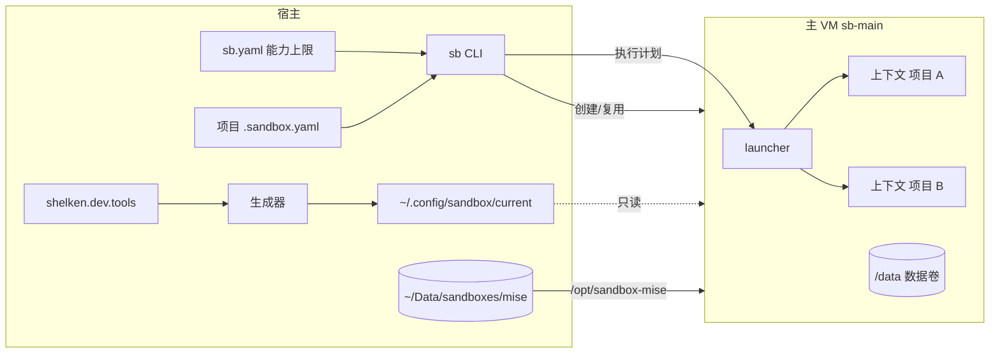

# Agent 沙箱

`sb` 与 `omp-sb`、`pi-sb` 等 harness 命令让 Agent 在 Linux 虚拟机里运行，只看得到当前项目。本文讲机制与取舍，日常操作见 [用户指南](../../../../docs/user-guide/03-agent-sandbox.md)

威胁模型只防 Agent 误操作（越界删除、误连其他项目的私网服务），不防恶意逃逸。项目内的误删靠启动前的宿主快照撤销。共享工具登记表的决策见 [ADR 0003](../../../../docs/adr/0003-shared-tool-single-declaration.md)

## 架构



入口 [default.nix](./default.nix) 装配 `_manifest.nix`、`_guest.nix`、`_config.nix`、`_host.nix` 四个模块，随 `ai` 能力默认启用

## 术语与不变量

- **主 VM (Main VM)**：长期运行的一台沙箱 VM，承载所有日常执行上下文
- **执行上下文 (Execution Context)**：一次 Agent 启动所见的受限环境，同一项目可同时存在多个
- **能力上限 (Capability Ceiling)**：主 VM 创建时固定的挂载根、VM 级网络策略、secret 与空闲超时，只能通过重建 VM 改变
- **能力授权 (Capability Grant)**：单次执行上下文实际获得的额外路径、导入文件和私网目标
- **批准 (Approval)**：宿主上对项目 `.sandbox.yaml` 规范化内容哈希的记录
- **执行计划 (Plan)**：host 到 guest 的唯一契约，类型在 [py/sb/plan.py](./py/sb/plan.py)，guest 仅 [guest/plan.sh](./guest/plan.sh) 解析，[py/test_contract.py](./py/test_contract.py) 校验两端一致
- **发布目录 (Published Config)**：宿主 `~/.config/sandbox/current` 指向的版本化目录，只读挂进 VM `/run/sandbox-config`，旧版本保留 7 天
- **共用安装层 (Shared Install Layer)**：宿主 `~/Data/sandboxes/mise/aarch64-linux` 挂到所有 VM `/opt/sandbox-mise` 的 mise 安装产物与下载缓存
- **声明配置 (Declared Config)**：共享工具登记表 `files` 发布的配置，上下文内由挂载强制只读；同目录里的**运行状态 (Runtime State)**（如数据库、登录态）照常可写、跨上下文共用、不写回宿主

核心不变量：

1. 启动新执行上下文不得停止、替换或破坏已运行的上下文，上下文内进程也不能修改自身授权
2. 能力授权始终是能力上限的子集；导入文件归宿主所有，上下文修改不写回
3. 补齐（`sb sync`）只补缺、不升级；执行上下文可写共用安装层安装项目工具
4. 上限指纹只含 guest 侧挂载声明，宿主路径变化不触发 VM 重建
5. 项目配置未批准或内容变更后不得启动上下文；批准只发生在宿主
6. 声明配置由只读挂载保证，运行中的上下文继续看到启动时的快照，新配置在新上下文生效

## 两层能力

**能力上限**定义在 [sb.yaml](./sb.yaml)（由 [py/sb/ceiling.py](./py/sb/ceiling.py) 解析），在主 VM 创建时固定；**能力授权**由项目根 `.sandbox.yaml` 声明（由 [py/sb/plan.py](./py/sb/plan.py) 校验，用法见 [用户指南](../../../../docs/user-guide/03-agent-sandbox.md)）。其中额外路径受 `mount_roots` 约束，导入文件与私网目标由 `sb trust` 批准决定

- **空闲超时**：`idle_timeout` 只把附着的 `msb exec` 会话算作活跃，上下文内 `nohup` 后台进程会随 VM 停止；`sb status` 执行一次 `msb exec` 会重置计时
- **secret 注入时机**：真实值只在 VM 创建与启动时由 `sb` 交给 msb，`exec` 与 `copy` 不注入，日常 `sb run` 不触发 `op run`
- **批准范围**：`sb trust` 对规范化内容做 SHA-256 记入宿主 `$MSB_HOME/approvals/`，只看内容不看路径，同一文件跨 worktree 只批准一次；沙箱内 `sb` 被宿主命令桩拒绝，Agent 无法批准自己

## 隔离边界与生命周期

执行上下文的隔离由 [launcher.sh](./launcher.sh) 与 `guest/` 实现，主 VM 的复用、重建与加锁状态机见 [py/sb/vm.py](./py/sb/vm.py)。有两个非显式约束需要注意：

- `/.msb/tls` 必须只读挂进上下文，它是 msb 的 CA，缺失时 OMP 的模型发现会全部失败
- 每个上下文独占 PID 命名空间，主命令退出后立即清场（TERM 后最多等 0.3 秒再 KILL），避免 detach 守护（如 `pi-intercom` broker）拖住 bubblewrap 退出，且不影响其他上下文

`sb.yaml` 对所有 secret 设置 `passthrough: ["*"]`，防止对话里带入的占位符在发往 `allow` 之外的目标时被 msb 切断连接（表现为首字节前 `ECONNRESET`）。这只保证连接不断，不保证占位符不外传：它是稳定的明文字符串，会被模型服务记录或回显；排查是否进入对话可在会话 jsonl 或 guest `exec.log` 里检索 `$MSB_`

已知安全局限：

- **私网在 VM 级放开**：不在上下文内运行的 guest 进程（`sb sync` 中的 mise / `bun install`、`msb exec` 的 root 进程）能访问私网；Agent 始终在上下文内，威胁模型只防误操作，因此接受
- **批准只覆盖 `.sandbox.yaml` 内容**：`imports.src` 指向的宿主文件内容变化不会触发重新批准，内容相同的 `.sandbox.yaml` 放在其他路径也视为已批准
- **`sb trust` 不逐项确认**：批准前需自行检查 `sb plan` 输出

## 工具与数据位置

宿主与沙箱共用的工具统一登记在 `shelken.dev.tools`（接口见 [dev/tools.nix](../../dev/tools.nix)，具体条目分布于 [dev/tools-base.nix](../../dev/tools-base.nix)、[ai/ai-tools.nix](../ai-tools.nix) 及各功能模块，宿主独有工具见 [ai/ai-apps.nix](../ai-apps.nix)）。沙箱内的 `AGENTS.md` 通过 `sandboxFiles` 附加 [AGENTS.sandbox.md](./AGENTS.sandbox.md)

两处非显式路径约定：

- 可写根（由 `shelken.dev.sandbox.writableRoots` 声明，当前为 `.omp/agent`、`.pi/agent`、`.agents`）落在 VM 数据卷 `/data/home/` 下，对宿主不可见；在上下文外（`sb sync`、`msb exec`）看到的只是指向只读发布目录的符号链接
- `.config/<X>` 声明配置只读挂载在 `$XDG_CONFIG_HOME/<X>`（`/data/xdg/config/<X>`），沙箱内没有 `/root/.config`

## 设计决策

### 宿主 CLI 用 Python，guest 脚本留在 shell

宿主 `sb` 处理合并 YAML、路径校验、指纹计算、批准记录和状态机，Python 让 `Plan` 成为带类型契约、`msb` 成为可替换 seam，生命周期可用假 `msb` 离线测试。guest 侧主要是调 `ip`、`iptables`、`bwrap`、`flock`，留在 shell 可避免 guest 闭包带入 Python

只用标准库，YAML 经 `yq` 转 JSON 而不用 PyYAML：批准哈希依赖 `yq`，换解析器会因 YAML 1.1 与 1.2 差异（如 `yes`/`no`、八进制）悄悄改变授权或令旧批准失效；指纹沿用 `jq -S -c` 规范化，避免存量主 VM 误判变更。`sb` 每次调 `msb` 都显式传解析后的 `MSB_HOME` 与 `MSB_CONFIG_PATH`，不依赖用户 shell 导出，确保锁与批准目录始终唯一

### 一台主 VM 承载所有执行上下文

日常同时在不同项目运行多个 Agent。microsandbox 0.7.7 的挂载、网络规则与 secret 在创建时固定，修改需重启并打断其他会话。因此用单台主 VM 承载所有执行上下文，跨上下文共用 `/data` 里的工具和 XDG 状态

放弃的方案：每项目一台 VM（4 并发宿主内存多约 1.1 GB）；切换项目时替换 VM（打断其他 Agent）；按 UID 过滤网络（guest 内核缺 iptables `owner` 模块）；VM 级挂载凭据目录（新增目录要重建 VM）；项目配置集中放宿主（新项目需另行登记）

代价：launcher 是唯一隔离执行者，漏洞或内核逃逸会暴露整个能力上限；公网只在 VM 级控制；单上下文耗尽内存可能波及其他上下文（实测见 wiki `microsandbox-concurrency-resource-cost`）

### 不做附加 VM、待升级登记和破坏性 sync

单项目专用 VM、忙时待升级登记、忙闲双模式 `sb sync` 都不在主路径上，反而集中制造并发状态问题，因此全部删繁就简：上限变化时仅空闲重建、忙则报错不登记；宿主只有一把生命周期锁，仅包住 VM 就绪过程，不阻塞上下文并发；`sb sync` 不区分忙闲也不拿生命周期锁

代价：主 VM 忙时需等空闲才能应用新上限；`sb sync` 会把插件目录与清单严格对齐，手工装的插件会被删；改 `sb.yaml` 后两秒内并发启动的两个 Agent 中后一个可能被重建打断，重跑即可

### 项目授权由宿主侧批准决定，私网在 VM 级整体放开

早期在 `sb.yaml` 逐项写允许的私网 IP 进 VM 配置有两个痛点：改一次授权就要等空闲重建 VM；上限是全局的，放进白名单的 IP 会被任意仓库的 `.sandbox.yaml` 直接申请。msb 的 `allow` 支持 `private` 组，而每个上下文已有按源地址隔离的 iptables 链（[launcher.sh](./launcher.sh)），VM 级逐项列 IP 是重复层

因此 VM 级放开私网，逐项限制交给上下文 iptables 链，导入文件与私网目标改由宿主 `sb trust` 批准决定（`paths` 仍受 `mount_roots` 约束）。放弃了「保留逐项上限」「批准绑定路径（每个 worktree 都要重批）」「交互式确认（会卡住后台脚本）」

### 默认放行模型服务的私网端口

模型服务解析到私网 IP，上下文默认拒绝全部私网，不放行时每个新项目都要先写 `.sandbox.yaml` 才能调模型，否则请求反复重试表现为卡住。`network.default_grant` 只接受 `IP:端口` 按端口收窄，属于上下文级授权，不进 VM 配置、不改指纹，改后下一个新上下文生效。放弃了按 IP 整体放行和逐项目声明

### 启动上下文前建宿主快照

项目根与 worktree 的 git common dir 对上下文可写直通宿主，Agent `rm -rf` 会直接删宿主文件。每次 `sb run` 前执行 `tmutil localsnapshot`（普通用户可跑、不到 1 秒、VM 内无法触及），失败只告警不阻断启动

局限：本地快照属可清除空间，磁盘紧张时系统会清理，只防近期误删，不覆盖远端破坏（如 force push）。放弃了 overlayfs（与宿主实时编辑冲突且需回写流程）和 `.git` 只读（无法 commit）

### 导入文件按目标目录绑定

home-ops 等项目通过 mise 固定如 `$HOME/.kube/home-ops.yaml` 这样的路径，旧方案固定挂 `/imports/<文件名>` 无法兼容。现在同一目标目录的导入共用一个暂存目录并整体绑定，权限 `600`，不写回宿主，OAuth 登录态也不导入（沙箱内登录一次存于 `/data/xdg/data/omp`）

放弃了单文件绑定（上下文内原子改名会报 `Device or resource busy`）和放进 `/data` 持久化（对其他项目可见）。代价是目标目录在上下文里只剩导入的文件

### agent 配置目录整体可写，声明配置逐项只读

早期把三个配置目录做成指向只读发布目录的符号链接，导致把运行状态写在配置旁的插件全部失败（如 pi-fff 数据库、pi-intercom 运行目录）。现在三个目录改为数据卷可写根，Nix 声明项逐项 `--ro-bind`：

- 嵌套声明项的祖先目录及各根上层目录也做成挂载点：内核只拦挂载点本身改名，改名普通祖先会把下方只读挂载一并移走，从而在原位建出可写替身（已实测）
- 挂载点会在数据卷留下空占位；当声明删除或类型改变时，旧占位会令 bwrap 启动失败或被工具当成真文件加载（例如空的 `guard.ts`），因此 launcher 在无其他上下文时按上次清单清理不符的空占位，非空内容一律不删
- 发布脚本保留旧版本 7 天，避免运行中的上下文因旧版本目录被删而读不到只读挂载

放弃了整目录只读（插件失败）、符号链接农场（原子替换即可绕过）、根清单硬编码在 launcher（易漏且留可改名祖先）、持久化整个 HOME（破坏 `imports` 隔离）

代价：每次启动多约 180 个挂载（约 35ms）；在可写根里新建的 `hooks/`、`tools/`、`RULES.md` 等会对后续所有项目生效；通过 `/data` 后备路径仍可改名可写根本身，留下不自动清理的孤儿目录

### pi 在上下文里自己装 packages

pi 启动时按 `settings.json` 的 `packages` 现场补装，包落在可写根由所有上下文共用。沙箱用 Nix 生成去掉 `sandboxExclude`（当前排除依赖 `node-pty` 的 `@shelken/simple-plannotator`）的 `settings.json`

`pi-dynamic-models` 由 Nix 开关控制：cpa、mp 等 provider 在 `models.json` 中没有静态 `models` 列表，靠它向网关发现；不把 `modelOverrides` 静态化成 `models`，否则约 50 个模型会退化成 128k/16k/仅文本且波及宿主

放弃了在 `sb sync` 中预装（sync 看的是只读发布目录）、`PI_OFFLINE=1`（会关掉模型发现）和忽略 bun 安装脚本（原生模块装上仍无法加载）。已知限制：新数据卷上同时首启多个 pi 可能失败，先单启一个装完再并发

### 共用 mise 安装层

把 mise 安装产物与下载缓存放在宿主共用目录挂到 `/opt/sandbox-mise`，避免数据盘重建或临时 VM 重复下载；`state`、`shims` 与用户层配置留在各 VM 数据盘

- `guest-env.sh` 把 `$SB_CONFIG_DIR/bin` 排在 `${guestEnv}/bin` 之前，使 mise shim 指向稳定的 `/run/sandbox-config/current/bin/mise`，避免 `just hm` 加 Nix GC 后旧 store 路径失效导致断链
- launcher 设 `MISE_PREFER_OFFLINE=1` 而不设 `MISE_OFFLINE=1`：已装的 `latest` 工具直接用本地版本免去联网查询，同时仍允许在上下文里 `mise install` 项目工具
- 宿主 `nix-icache on` 时，每次进入 VM 前以 `MISE_URL_REPLACEMENTS` 环境变量传入改写规则（见 [nix-icache/default.nix](../../nix/nix-icache/default.nix)），不写 guest 配置文件，因为 VM 看不到宿主文件且上下文由宿主现启动
- 上下文对共用层可写，不再为防误操作锁成只读：Agent 本就能下载运行任意程序，只读反而让项目 `mise.toml` 工具（kustomize、helm、flux 等）装不上，并发安装同版本由 mise 自身串行
- 沙箱基础环境刻意不带 C 工具链，唯一依赖它的 `simple-plannotator` 已排除，省下约 331 MiB 闭包

代价：共用层损坏会影响所有 VM（用 `sb sync` 自愈），宿主约占 1 至 2 GB；需要现场编译的原生扩展（如 `node-pty`、原生 `pipx:` 包）装不上；上下文内 `mise uninstall`/`prune` 会删掉全局共用版本；未启用 mise shell 激活，新工具需先 `mise install` 生成 shim

## 测试

一次性 `MSB_HOME` 端到端冒烟测试（需要宿主有 `msb`、ubuntu 镜像缓存、公网与 Linux 构建器，可用 `SB_BIN` 覆盖现场构建）：

```bash
bash modules/features/ai/sandbox/e2e/smoke.sh
```

完整行为验证流程见项目技能 [verify-sandbox](../../../../.agents/skills/verify-sandbox/SKILL.md)。宿主 CLI 单元测试（无需 VM，PR 由 [sandbox-host-tests](../../../../.github/workflows/sandbox-host-tests.yml) 自动运行）：

```bash
cd modules/features/ai/sandbox/py && nix shell nixpkgs#python3 nixpkgs#bash nixpkgs#jq nixpkgs#yq-go nixpkgs#git -c python3 -m unittest discover
```
