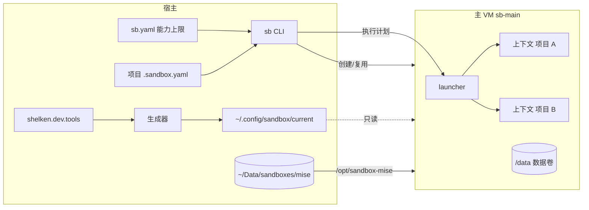
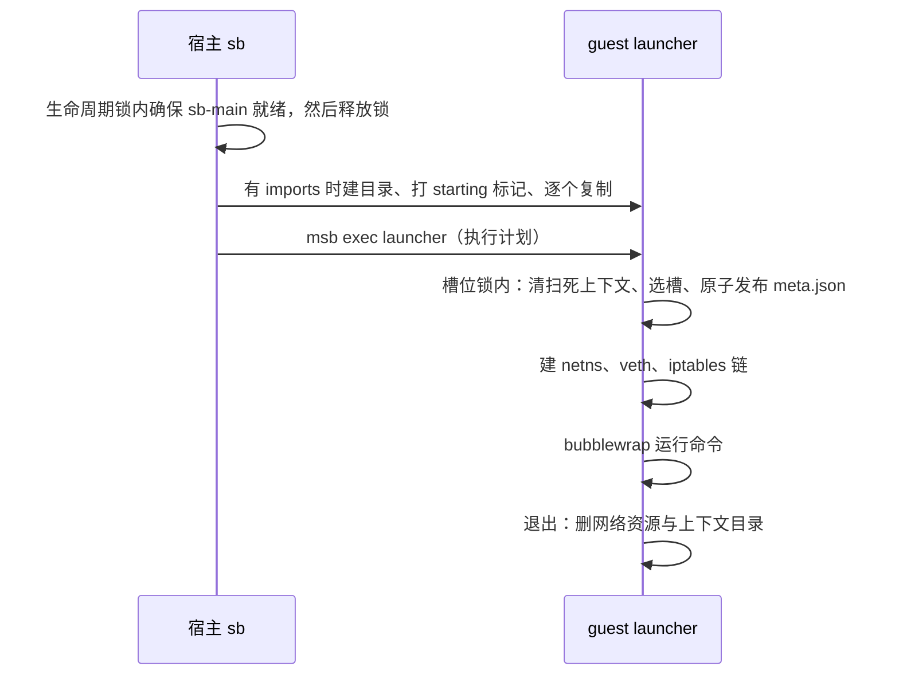

# Agent 沙箱

`sb` 与 `omp-sb` 让 Agent 在 Linux 虚拟机里运行，只看得到当前项目。本文讲机制；日常操作见 [用户指南](../../../../docs/user-guide/03-agent-sandbox.md)

威胁模型只防 Agent 误操作（越界删除、误连其他项目的私网服务），不防恶意逃逸。设计原因见文末「设计决策」；共享工具登记表的决策见 [ADR 0003](../../../../docs/adr/0003-shared-tool-single-declaration.md)

由 `shelken.dev.ai.sandbox.enable` 控制，默认关闭

## 架构



| 组件 | 文件 | 职责 |
| --- | --- | --- |
| 宿主 CLI | [sb.sh](./sb.sh)、[_sb.nix](./_sb.nix) | 读上限、解析项目计划、管理主 VM 生命周期、复制 imports、调用 launcher |
| launcher | [launcher.sh](./launcher.sh)、[_launcher.nix](./_launcher.nix) | 在 guest 内以 root 建网络与 bubblewrap 视图，运行命令，退出清理 |
| 生成器 | [_generator.nix](./_generator.nix)、[sync-guest.sh](./sync-guest.sh) | 由登记表生成 guest 环境、mise 配置、OMP 配置与 sync 脚本 |
| 状态查询 | [guest-status.sh](./guest-status.sh) | 列出缺失的 mise 工具，供 `sb status` 使用 |
| 能力上限 | [sb.yaml](./sb.yaml) | 部署到 `~/.config/sandbox/sb.yaml`，`SB_CONFIG` 可覆盖 |

## 术语与不变量

- **主 VM (Main VM)**: 长期运行的一台沙箱 VM，承载所有日常执行上下文。_避免_: 全局 VM、sb-default
- **执行上下文 (Execution Context)**: 一次 Agent 启动所见的受限环境，由当前项目、导入文件和获准的网络目标组成。同一项目可同时存在多个。_避免_: 会话、实例、槽位
- **能力上限 (Capability Ceiling)**: 一台沙箱 VM 创建时固定的挂载根、VM 级网络策略（公网、DNS、私网整体放开）和 secret 集合，只能通过重建 VM 改变
- **能力授权 (Capability Grant)**: 某个执行上下文实际获得的额外路径、导入文件和私网目标。额外路径是挂载根的子集；导入文件和私网目标没有上限，由批准决定
- **批准 (Approval)**: 用户用 `sb trust` 对项目 `.sandbox.yaml` 的规范化内容哈希做的记录。未批准或内容变了，启动直接报错
- **项目配置 (Project Config)**: 项目仓库根 `.sandbox.yaml`，请求导入文件、私网目标和额外目录；批准后才生效
- **沙箱基础环境 (Sandbox Base)**: 沙箱启动和隔离所需的 Linux 工具，由 sandbox 模块管理，不属于共享工具
- **补齐 (Sync)**: 显式安装已登记但缺失的 mise 工具和插件，只增不删，不升级已有项。_避免_: 升级、更新
- **共用安装层 (Shared Install Layer)**: 宿主上由所有沙箱 VM 共用的一份 mise 安装产物与下载缓存。_避免_: 共享缓存、镜像卷

不变量：

1. 启动执行上下文不得停止、替换或破坏其他已运行的执行上下文
2. 能力授权始终是能力上限的子集
3. 执行上下文内的进程不能改变自己的能力授权
4. 导入文件归宿主所有，执行上下文的修改不写回宿主
5. 工具的升级只由用户主动触发，补齐不改变已安装项
6. 执行上下文对共用安装层只读；写入（安装）只经 `sb sync` 在上下文外发生
7. 上限指纹只含 guest 侧挂载声明，不含宿主真实路径；宿主路径变化不触发 VM 重建
8. 项目配置未批准或批准后内容变了，不得启动执行上下文；批准只发生在宿主上

## 两层能力

**能力上限**在主 VM 创建时固定：挂载根、VM 级网络策略、secret 都写进 msb 配置，运行中改不了。**能力授权**在每次启动上下文时由 launcher 授予：额外路径受挂载根约束；导入文件和私网目标没有上限，由用户用 `sb trust` 批准

### 上限：`sb.yaml`

| 字段 | 默认 | 说明 |
| --- | --- | --- |
| `image` | `ubuntu` | VM 镜像 |
| `cpus` / `memory` | `4` / `8G` | VM 规格 |
| `volume.name` / `volume.size` | `sb-main-data` / `8G` | 挂到 `/data` 的 ext4 数据卷，不存在时自动创建 |
| `mount_roots` | 无 | 挂载根，支持 `~`、`${HOME}`；先解析符号链接，guest 内路径与宿主一致 |
| `network.allow` | `public`、`dns` | VM 级网络策略（msb 规则语法）：`public`、`dns`、`private`、`host:tcp:<端口>`。`private` 整体放开私网，逐项限制由上下文内的 iptables 链完成；改它会改变上限指纹、触发重建 |
| `network.default_grant` | 无 | 所有上下文默认放行的私网 `IP:端口`；不进 VM 配置，改了不触发重建 |
| `secrets` | 无 | `变量名: { allow: [域名或 IP], passthrough: [域名] }`，真实值由宿主 `sec-run` 注入；`allow` 是替换真实值的目标，`passthrough` 是占位符原样放行的目标（当前全部为 `*`，原因见「网络与 secret」）；改它会改变上限指纹、触发重建 |

### 授权：项目 `.sandbox.yaml`

| 字段 | 校验 | 落地方式 |
| --- | --- | --- |
| `imports` | 每项写 `src` 与 `target`；`src` 必须是存在的宿主文件；`target` 以 `~/` 或 `/` 开头、不含 `..`、位于子目录内，且不在沙箱保留位置（系统目录、`/data`、`~/.omp`、`~/.agents`、`~/.pi`） | 宿主 `msb copy` 进 guest 的暂存目录，目标目录整体绑定为该暂存目录（目录形式，支持原子改名），退出删除，不写回 |
| `network` | 只接受 `IP` 或 `IP:端口` | 上下文专有 iptables 链里先于私网拒绝规则放行 |
| `paths` | 必须在 `mount_roots` 内 | 同路径绑定，`:ro` 或 `readonly: true` 为只读 |

此外两项自动授权：项目根（git 仓库根，不在仓库内时取当前目录）可写绑定；worktree 的 git common dir 不在项目内时自动加绑，它不在挂载根内则拒绝启动

**批准**：项目有 `.sandbox.yaml` 时，`sb run`、`sb shell`、`omp-sb` 要求它已批准，否则直接报错并提示 `sb trust`，不弹提示、不等待输入。`sb trust` 对规范化内容（键排序、去注释，只改格式或注释不失效）算 SHA-256，记入 `$MSB_HOME/approvals/<哈希>`。批准只看内容、不看路径，所以同一份文件在所有 worktree 里只批准一次；文件一变（包括被 Agent 修改）就要重新批准。`sb plan` 显示批准状态。记录在宿主上，沙箱里的 `sb` 被宿主命令桩拒绝，Agent 批准不了自己

## 执行上下文

每次 `sb run`、`sb shell`、`omp-sb` 新建一个上下文，流程：



- **视图**：bubblewrap 映射到 UID 1000，只读绑定 `/usr`、`/etc`、`/nix/store`、`/.msb/tls`（msb CA，`NODE_EXTRA_CA_CERTS` 指向这里，缺失时 OMP 的模型发现全部失败）、共用 mise 层与配置目录；可写绑定 `/data`、项目根、额外路径与 imports 的目标目录（该目录在上下文里只剩导入的文件）。`/run` 是 tmpfs，上下文看不到 `/run/sandbox/contexts` 里其他上下文的 imports。launcher 预先创建 `/data/xdg/*/omp`，OMP 只在这些目录存在时才把数据库放到 `/data`
- **网络**：每个槽位一个 `/30` 子网（`10.200.x.y`），独立 netns 与 veth，NAT 出口。地址池 64 个，即单台主 VM 最多 64 个并发上下文
- **并发**：清扫、选槽、发布 `meta.json` 在 guest 内一把 flock 下串行；网络资源按唯一槽位命名，不会互相覆盖。cleanup 只删 `meta.json` 归属本进程的资源
- **复制窗口**：宿主复制 imports 期间目录还没有 `meta.json`，靠 `starting` 标记保护：120 秒宽限内清扫跳过它，忙碌计数也算上它。复制失败或宿主中断时宿主删除该目录
- **残留清扫**：每次启动、`sb status`、忙碌判断都会清理 PID 已死的上下文，以及没有登记的 `vth*` 接口

## 网络与 secret

上下文专有链的规则顺序：

1. DNS（guest `/etc/resolv.conf` 中的 nameserver，53 端口）
2. `sb.yaml` 中的 `host:tcp:<端口>`
3. `network.default_grant` 与项目声明的私网目标
4. 拒绝 `10/8`、`172.16/12`、`192.168/16`、`100.64/10`、`169.254/16`
5. 其余公网放行（含 fake-ip 段 `198.18/15`）

FORWARD 默认 DROP。公网只在 VM 级控制，不做上下文级限制

secret 由 msb 在网络边界替换：guest 内只有 `$MSB_<名字>` 占位符，请求发往该 secret 的 `allow` 目标时才换成真实值，token 不落盘。GitHub 的 `git@github.com:` remote 在 guest 内改写为 HTTPS，配合 `GITHUB_TOKEN` 占位符认证；不共享宿主 SSH 私钥

占位符本身也会进入对话：Agent 读到含 `$MSB_<名字>` 的文件或文档、执行 `env` 时，它就留在上下文里，随后每一轮请求体都带着它发往模型服务。msb 对发往 `allow` 之外目标的占位符默认拦截并切断连接，客户端看到的是首字节前的 `ECONNRESET`，`usage` 全为 0。所以 `sb.yaml` 给每个 secret 设 `passthrough: ["*"]`：占位符原样发往任何目标，**凭据**不会泄露，真实值仍只替换给 `allow` 里的目标

这只保证连接不断，不保证占位符不外传：它是稳定的明文字符串，会随请求离开本机，被模型服务和中间方记录，模型也可能把它回显到输出。`passthrough` 生效后 msb 不再产生 `secret violation`，宿主 `runtime.log` 也就不能再用来发现占位符进了对话；要确认，在会话 jsonl 或 `~/Data/sandboxes/msb/sandboxes/sb-main/logs/exec.log` 里 grep `$MSB_`

### 已知局限

- **私网在 VM 级是放开的。** 只有执行上下文内的进程受上下文链约束；不在上下文里运行的 guest 进程（`sb sync` 里的 mise 与 `bun install`、`msb exec` 进入的 root 进程）也能连私网。威胁模型只防 Agent 误操作，Agent 始终在上下文内，所以接受
- **批准只覆盖 `.sandbox.yaml` 的内容。** `imports.src` 指向的宿主文件内容变了不需要重新批准；内容相同的 `.sandbox.yaml` 放在别处也视为已批准
- **`sb trust` 不逐项确认。** 它直接记录批准，批准前要自己先看 `sb plan` 的清单

## 主 VM 生命周期

`sb.yaml` 生成的 msb 配置做 SHA-256 得到上限指纹，记在 VM label 与 `$MSB_HOME/sandboxes/sb-main/ceiling.hash`。指纹里的共用 mise 挂载被规范化为占位符，宿主路径不影响指纹

| 情况 | 行为 |
| --- | --- |
| VM 不存在 | 创建数据卷与 VM，自动执行一次 `sb sync` |
| 指纹一致 | 运行中直接复用，停止则启动 |
| 指纹不一致且空闲 | 删除并按新上限重建，数据卷保留 |
| 指纹不一致且有上下文在运行 | 报错并给出上下文数，不打断任何上下文，也不登记状态 |

创建、启动、重建、停止、删除都在宿主生命周期锁（`$MSB_HOME/locks`）内进行；锁只在 VM 就绪前持有，不阻塞上下文并发。`sb rm` 有上下文在运行时拒绝，`--force` 强制

## 工具

### 共享工具登记表

`shelken.dev.tools.<名字>` 只登记宿主与沙箱都需要的工具，接口在 [dev/tools.nix](../../dev/tools.nix)：

| 字段 | 说明 |
| --- | --- |
| `package` | nixpkgs 属性名，默认取登记名；与 `mise` 互斥 |
| `mise` | mise 规格，版本字符串或属性集 |
| `files` | 随工具进沙箱的配置文件，宿主照常作为 `home.file` |
| `postInstall` | 宿主激活时与 `sb sync` 时各运行一次 |

条目在 [dev/tools-base.nix](../../dev/tools-base.nix)（rg、fd、jq、gh、node、python3、uv）与 [ai/tools.nix](../tools.nix)（omp、pi、codex、claude-code、bun）。宿主独有的工具不登记

生成器把 Nix 条目合成 guest PATH（来自 `/nix/store` 只读挂载），把 mise 条目写成 `/run/sandbox-config/current/mise.toml`。`sb`、`just`、`spawn-subagent`、`computer-use` 等宿主控制命令在 guest PATH 里是同名桩，调用时以非零码退出并说明原因（[shelken.dev.sandbox.hostCommands](../../dev/tools.nix)）

### 共用 mise 安装层

mise 的安装目录与下载缓存放在宿主 `~/Data/sandboxes/mise/aarch64-linux`（`SB_MISE_HOST_DIR`，首次使用自动创建），挂到所有 VM 的 `/opt/sandbox-mise`，新 VM 不必重新下载。mise 的 state、shims 与用户层配置 `/data/mise/config.toml` 留在各 VM 数据卷

上下文对共用层只读，并设 `MISE_AUTO_INSTALL=0`，Agent 无法在沙箱内安装工具。launcher 还设 `MISE_OFFLINE=1`：上下文里 mise 不发网络请求，项目 `mise.toml` 里写 `latest` 的工具解析不出版本，只给一条警告，不再每次启动白等超时（实测 minio/mc 的版本列表约 14 MB，超过 mise 的超时，缓存写不进去）。`sb sync` 不在上下文里，不受影响

### `sb sync`

在 VM 内（不在上下文内）运行 [sync-guest.sh](./sync-guest.sh)：

- 跨 VM 的写锁：共用目录下的 `.sync.lock`
- `mise install` 只补缺，不升级、不删除；不区分 VM 忙闲
- 运行各工具的 `postInstall`，其中 OMP 插件按 [package.json](../omp/plugins/package.json) 执行 `bun install --ignore-scripts`，只补缺。私有仓库用 `GITHUB_TOKEN` 占位符 clone，失败只警告。`node-pty` 因不跑安装脚本而不可用，原因见「设计决策」

## 配置与数据位置

| 内容 | 位置 |
| --- | --- |
| 发布给 guest 的配置 | 宿主 `~/.config/sandbox/current`（Nix store 链接），guest `/run/sandbox-config/current` |
| OMP 配置、skills | 上下文内只读 `/root/.omp/agent`、`/root/.agents` |
| OMP 数据、会话、插件 | `/data/xdg/*/omp`（插件在 `/data/xdg/data/omp/plugins`），所有上下文共用一份 |
| pi-fff 的 frecency/history 数据库 | `/data/xdg/data/pi-fff`（`guest-env.sh` 设 `FFF_FRECENCY_DB`、`FFF_HISTORY_DB`）；默认位置 `~/.pi/agent/fff` 在只读的发布目录里，建库会报 `Read-only file system` |
| msb 运行数据 | `~/Data/sandboxes/msb`（`MSB_HOME`），镜像缓存 `~/.cache/microsandbox` |

旧数据卷上的 `/data/omp/plugins`（约 800 MB）不再使用，不会自动清理，确认后可手动删除；`sb sync` 会在新位置重建，需要重新 clone 私有插件仓库并安装 npm 包

配置发布后，复用中的 VM 新开的上下文即读到新配置，不改指纹，不触发重建。guest 不跟随宿主 live-edit 软链

## 设计决策

每节记录为什么这样设计、考虑过的替代方案和代价。机制本身见上文各节

### 一台主 VM 承载所有执行上下文

日常习惯是多个 OMP 同时在不同项目运行。每个项目一台 VM，内存成本高、管理也更复杂；把整个 `~/Code` 可写挂载给一台 VM，Agent 又能误删其他项目。microsandbox 0.7.7 的挂载、网络规则和 secret 在 VM 创建时固定，运行中修改要重启，会打断同一 VM 内其他 OMP。复现：

```bash
msb modify --help
PROBE=x msb modify --secret PROBE@example.com --dry-run <sandbox>
```

所以只有一台主 VM，每次启动新建一个执行上下文，同项目可并存多个，启动新上下文不影响已运行的上下文。OMP 数据、工具和缓存在所有上下文内共用一份可写状态，与宿主多个 OMP 共用一份 XDG 数据的语义一致

考虑过的替代方案：

- **每个项目或每个 OMP 一台 VM**：并发 4 个时启动后宿主内存约 2.8 至 2.9 GB，比单 VM 多约 1.1 GB，还要管理多台 VM
- **单活动槽位，切换项目时替换 VM**：会打断其他项目正在运行的 OMP
- **私网项目使用单独 VM**：每个上下文独立网络命名空间已能在主 VM 内按项目精确放行私网目标
- **guest 内按 UID 过滤网络**：guest 内核缺少 iptables `owner` 匹配模块，做不到
- **VM 级挂载凭据目录**：新增目录要重建 VM；运行时复制不需要，并保证宿主文件不被写回
- **项目配置放宿主集中目录**：Agent 无法修改，但新项目要在另一处登记。现在 Agent 改仓库内的 `.sandbox.yaml`，下次启动前必须由用户重新批准

代价：

- launcher 是唯一的隔离执行者。launcher 缺陷或内核逃逸会暴露整个能力上限，所以上限必须是可接受的最坏情况
- 公网只在 VM 级控制，不做上下文级限制；按项目精确控制只覆盖私网目标
- 同一主 VM 内某个上下文耗尽内存，可能波及其他上下文
- 资源与隔离实测记录见 wiki 页面 `microsandbox-concurrency-resource-cost`

### 不做附加 VM、待升级登记和破坏性 sync

宿主 CLI 一度增长到约 1300 行，四轮审查的问题大多集中在三处：附加 VM 的并发生命周期（同时首次进入、最后退出撞上新进入、各自数据盘与 shims）、主 VM 忙时的待升级登记、`sb sync` 的忙闲两套模式及其与生命周期的竞态。日常使用是多个项目、多个 Agent 同进同一台主 VM，这些机制都不在这条主路径上，所以不做：

- 不提供单项目专用 VM。所有执行上下文都在主 VM，隔离由执行上下文提供
- 能力上限变化时，主 VM 空闲则下一次启动自动重建；仍有执行上下文则报错并给出上下文数，不登记待升级
- 只用一把宿主生命周期锁，只包住「检查上限指纹、必要时重建、启动 VM」。不做宿主侧预约，忙闲只看 guest 内 launcher 的上下文登记
- `sb sync` 永远只补缺，不区分忙闲，不删除、不重建插件依赖，因此不需要判断忙闲，也不需要生命周期锁
- `sb status` 只报告缺失的 mise 工具，不报告插件安装状态

代价：

- 主 VM 忙时，某项目需要超出当前上限的能力，只能等主 VM 空闲后重建
- `sb status` 不显示待升级，也不显示插件是否装全；插件结果只看 `sb sync` 输出
- 沙箱里手装的插件、或已从清单删除的插件不会被自动清掉，需要时用 `sb volume` 清理数据盘
- 改了 `sb.yaml` 且两个 Agent 在同一两秒内启动时，后启动的上下文可能在启动阶段被重建打断，重新启动即可
- 忙时 `sb sync` 可能在运行中的 OMP 底下更新插件文件；插件已加载进内存，风险低

### 项目授权由宿主侧批准决定，私网在 VM 级整体放开

最初 `sb.yaml` 的 `network.allow` 逐项列出项目可申请的私网 IP，并写进 msb 的 VM 配置。这带来两个问题：

1. 改授权就要重建主 VM，而重建要求没有 Agent 在运行，日常同时开着多个 Agent 时几乎总被挡住
2. 上限是全局的。一个 IP 放进 `allow` 后，任何项目的 `.sandbox.yaml` 都能申请，而它在仓库里，Agent 改了就在下次启动生效

实测 msb 的 `allow` 支持 `private` 目标组：只写 `public` 时，对内网 kube-apiserver 的明文 HTTP 请求被拒绝连接，加上 `private` 后收到应用层的 `400 Bad Request`。而每个执行上下文的 iptables 链本来就按源地址逐项限制私网目标（[launcher.sh](./launcher.sh)），VM 级逐项列 IP 是重复的一层。

所以 VM 级放开私网，逐项限制只由上下文内的 iptables 链完成；导入文件和私网目标不设上限，是否放行由 `sb trust` 的批准决定。`paths` 仍受 `mount_roots` 限制，因为挂载是 VM 级的，同样计入批准。批准记录在宿主上，Agent 批准不了自己

考虑过的替代方案：

- **保留逐项上限，只放宽重建条件**：不改变信任模型，Agent 改文件仍然自动扩权
- **批准按路径加哈希**：同一份文件在每个 worktree 里都要重新批准，没有收益
- **交互式提示**：在后台、脚本、自动开 Agent 的场景会卡住
- **宿主侧项目授权文件（不进仓库）**：原本为公开仓库不能写内网 IP 设计，核实后仓库已大量包含内网 IP，这个理由不成立，需要时再加

代价：

- 改授权（新增一个 IP、换一个导入文件）不再触发 VM 重建，也不被运行中的 Agent 挡住
- 批准不覆盖 `imports.src` 指向的宿主文件的内容变化
- 改 `network.allow` 的 VM 级策略仍会改变上限指纹、触发一次重建
- 不在上下文里运行的 guest 进程也能连私网，见「已知局限」

### 默认放行模型服务的私网端口

家里的模型服务（`cpa.int.ooooo.space`、`commandcode.int.ooooo.space`）都解析到私网 `192.168.69.46`。执行上下文默认拒绝全部私网，每个项目都要在 `.sandbox.yaml` 声明这个 IP，OMP 才能调用模型；不声明时默认模型请求反复重试，表现为卡住。模型服务是每个 Agent 都要用的基础依赖，不属于某个项目

所以 `sb.yaml` 的 `network.default_grant` 列出所有上下文默认放行的私网目标，只接受 `IP:端口`，当前只放行 `192.168.69.46:443`。范围按端口收窄，同一台机器的其他端口仍需项目声明。它是上下文级授权，不写进 VM 配置、不改变上限指纹，修改后下一个新上下文即生效

考虑过的替代方案：

- **按 IP 整体默认放行**：配置更简单，但所有项目都能访问该机器上的全部服务
- **保持每个项目声明**：不改代码，但每个新项目都要先写 `.sandbox.yaml` 才能用 OMP

### 导入文件按目标目录绑定

原来 `imports` 只能把文件放到上下文内的 `/imports/<文件名>`。home-ops 这类项目用 mise 把 `KUBECONFIG` 固定为 `$HOME/.kube/home-ops.yaml`，工具只认这个路径，所以没法用

所以每项写 `src` 与 `target`。同一目标目录的导入共用一个暂存目录，launcher 把它整体绑定到该目录，不做单文件绑定，否则上下文内的原子改名会报 `Device or resource busy`（实测）。保留位置不能做目标目录：家目录本身、`/`、系统目录、`/data`、`/run`、`/.msb`，以及 launcher 铺设配置链接的 `~/.omp`、`~/.agents`、`~/.pi`；同一个 `target` 不能重复。导入文件在上下文内只对上下文用户可读写（`600`）

不做：

- OAuth 登录态不导入。OMP 的登录态在 `agent.db`，位于共享的 `/data/xdg/data/omp`，在沙箱里登录一次即可持久化并被所有项目共用
- 不写回宿主。上下文内的修改随上下文退出丢弃

考虑过的替代方案：

- **单文件绑定**：目录遮蔽的副作用消失，但原子改名失败
- **把凭据放进 `/data` 持久化**：`/data` 绑进所有上下文，项目凭据会对其他项目可见

代价：目标目录在上下文里只剩导入的文件

### 共用 mise 安装层

主 VM 数据盘坏掉重建、一次性 e2e VM 启动时，mise 工具（bun、codex、oh-my-pi 等）和 OMP 插件都要重新下载安装，下载量大、耗时长。另外，若把宿主真实路径直接写进 VM 挂载配置，路径变化（如用户名、目录调整）会改变上限指纹，让复用中的 VM 被判定「上限不一致」而重建

所以：

- 宿主只有一个共用目录，取真实物理路径（非符号链接）；msb 解析符号链接后仍指向同一目录
- 所有 VM 一律把它挂到 `/opt/sandbox-mise`。上限指纹只含 guest 侧声明 `/opt/sandbox-mise:rw`，不含宿主真实路径，宿主路径变化不触发重建
- 共用的只有安装产物与下载缓存；mise 的 `state`、`shims` 与可写用户层配置仍归各 VM 数据盘
- guest 环境变量只有一个来源 `/run/sandbox-config/current/guest-env.sh`，由生成器生成，`sb sync`、执行上下文、legacy 入口统一 source
- `sb sync` 在宿主侧经 flock（共用目录下的 `.sync.lock`）串行化，多 VM 并发 sync 不交叉写安装层
- sync 不清理下载缓存，共用的下载缓存是资产
- 主 VM 首次创建后自动 sync 一次；`sb run`、`sb shell`、`omp-sb` 复用已有 VM 时不自动 sync
- OMP 插件在 guest 内按仓库清单完整重放。带 GitHub 有效凭据时，`git+ssh://git@github.com/...` 源改写为 `https://github.com/...`，凭据经 `GIT_CONFIG_GLOBAL` 的 `insteadOf` 指向占位符 URL `$MSB_GITHUB_TOKEN`（由 `sb.yaml` 的 `secrets` 声明，msb 在网络边界替换），token 不落盘、不进日志、不进进程参数
- 私有插件能装就装：VM 本地 `.git-vendor` 已有同一依赖且 ref 一致时直接复用；否则对该 git 源做一次禁交互的浅 clone（`GIT_TERMINAL_PROMPT=0`、`--depth 1`，带 ref 时 `--branch`），以 `file:` 依赖安装。clone 失败只在 `sb sync` 输出中警告，不区分原因，退出码不受影响
- 不执行依赖安装脚本（`bun install --ignore-scripts`）：`node-pty`（`@plannotator/webtui` 的依赖）在 Linux 无预编译产物，安装脚本回落 `node-gyp rebuild`，需要 C 工具链。实测补齐 gcc-wrapper 的闭包增量 1.3 GiB（gcc-wrapper 370 MiB、binutils 121 MiB、isl/mpfr/mpc/gcc 等），远超 200 MiB 预算，所以不引入编译器。`node-pty` 只供 plannotator 的终端桥接，不参与插件加载。将来确需本地终端桥接，再单独评估工具链预算

代价：

- 共用安装层损坏影响所有 VM，用 `sb sync` 重装自愈
- 宿主目录体积随工具增长（约 1 至 2 GB 量级）
- 无凭据环境下私有插件不可用，只在 `sb sync` 输出中提示
- `node-pty` 的原生桥接在沙箱内不可用

## 测试

[e2e/smoke.sh](./e2e/smoke.sh) 在一次性 `MSB_HOME` 中启动临时 VM，断言四项隔离边界：相邻项目不可见、未声明私网无应用层响应、secret 在出口被替换、worktree 内可提交

```bash
bash modules/features/ai/sandbox/e2e/smoke.sh
```

需要宿主有 `msb`、ubuntu 镜像缓存、能访问公网与 Linux 构建器；默认现场构建 `sb`，可用 `SB_BIN` 指定。测试只读挂载共用 mise 层，不触发 `sb sync`

冒烟测试之外的行为验证（首次启动、OMP 调模型、sync、生命周期与授权）见项目技能 [verify-sandbox](../../../../.agents/skills/verify-sandbox/SKILL.md)
