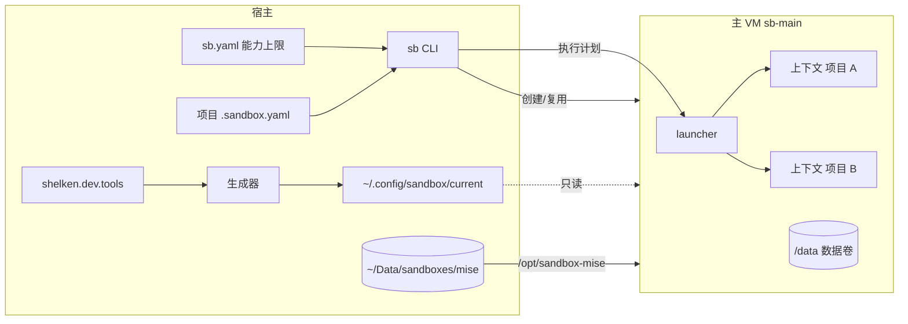
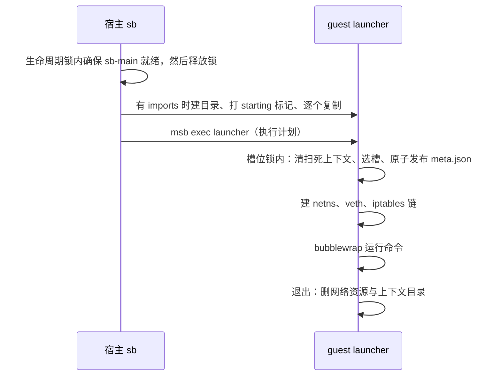

# Agent 沙箱

`sb` 与 `omp-sb` 让 Agent 在 Linux 虚拟机里运行，只看得到当前项目。本文讲机制；日常操作见 [用户指南](../../../../docs/user-guide/03-agent-sandbox.md)

威胁模型只防 Agent 误操作（越界删除、误连其他项目的私网服务），不防恶意逃逸。决策依据：

- [ADR 0002](../../../../docs/adr/0002-single-main-vm-execution-context.md)：单主 VM 加执行上下文
- [ADR 0003](../../../../docs/adr/0003-shared-tool-single-declaration.md)：共享工具单一声明
- [ADR 0005](../../../../docs/adr/0005-shared-mise-install-layer.md)：共用 mise 安装层
- [ADR 0006](../../../../docs/adr/0006-sandbox-razor.md)：删除附加 VM、待升级登记与忙时 sync
- [ADR 0007](../../../../docs/adr/0007-sandbox-default-grant.md)：所有上下文默认放行的私网端口（家里的模型服务）

由 `shelken.dev.ai.sandbox.enable` 控制，默认关闭

## 架构



| 组件 | 文件 | 职责 |
| --- | --- | --- |
| 宿主 CLI | [sb.sh](./sb.sh)、[_sb.nix](./_sb.nix) | 读上限、解析项目计划、管理主 VM 生命周期、复制 imports、调用 launcher |
| launcher | [launcher.sh](./launcher.sh)、[_launcher.nix](./_launcher.nix) | 在 guest 内以 root 建网络与 bubblewrap 视图，运行命令，退出清理 |
| 生成器 | [_generator.nix](./_generator.nix)、[sync-guest.sh](./sync-guest.sh) | 由登记表生成 guest 环境、mise 配置、OMP 配置与 sync 脚本 |
| 状态查询 | [guest-status.sh](./guest-status.sh) | 列出缺失的 mise 工具，供 `sb status` 使用 |
| 能力上限 | [sb.yaml](./sb.yaml) | 部署到 `~/.config/sandbox/sb.yaml`，`SB_CONFIG` 可覆盖 |

## 两层能力

**能力上限**在主 VM 创建时固定：挂载根、网络、secret 都写进 msb 配置，运行中改不了。**能力授权**在每次启动上下文时由 launcher 授予，只能是上限的子集

### 上限：`sb.yaml`

| 字段 | 默认 | 说明 |
| --- | --- | --- |
| `image` | `ubuntu` | VM 镜像 |
| `cpus` / `memory` | `4` / `8G` | VM 规格 |
| `volume.name` / `volume.size` | `sb-main-data` / `8G` | 挂到 `/data` 的 ext4 数据卷，不存在时自动创建 |
| `mount_roots` | 无 | 挂载根，支持 `~`、`${HOME}`；先解析符号链接，guest 内路径与宿主一致 |
| `network.allow` | `public`、`dns` | 另可写 `host:tcp:<端口>` 与私网 IP（精确匹配，不支持 CIDR） |
| `network.default_grant` | 无 | 所有上下文默认放行的私网 `IP:端口`，IP 须在 `network.allow` 内；不进 VM 配置，改了不触发重建 |
| `secrets` | 无 | `变量名: { allow: [域名或 IP] }`，真实值由宿主 `sec-run` 注入 |

### 授权：项目 `.sandbox.yaml`

| 字段 | 校验 | 落地方式 |
| --- | --- | --- |
| `imports` | 宿主文件必须存在 | 宿主 `msb copy` 进 guest，绑定为上下文的 `/imports`，退出删除，不写回 |
| `network` | 必须出现在 `network.allow` | 上下文专有 iptables 链里先于私网拒绝规则放行；支持 `IP` 与 `IP:端口` |
| `paths` | 必须在 `mount_roots` 内 | 同路径绑定，`:ro` 或 `readonly: true` 为只读 |

此外两项自动授权：项目根（git 仓库根，不在仓库内时取当前目录）可写绑定；worktree 的 git common dir 不在项目内时自动加绑，它不在挂载根内则拒绝启动

Agent 改 `.sandbox.yaml` 最多在上限内扩权，并且下次启动才生效

## 执行上下文

每次 `sb run`、`sb shell`、`omp-sb` 新建一个上下文，流程：



- **视图**：bubblewrap 映射到 UID 1000，只读绑定 `/usr`、`/etc`、`/nix/store`、`/.msb/tls`（msb CA，`NODE_EXTRA_CA_CERTS` 指向这里，缺失时 OMP 的模型发现全部失败）、共用 mise 层与配置目录；可写绑定 `/data`、项目根、额外路径与 `/imports`。`/run` 是 tmpfs，上下文看不到 `/run/sandbox/contexts` 里其他上下文的 imports。launcher 预先创建 `/data/xdg/*/omp`，OMP 只在这些目录存在时才把数据库放到 `/data`
- **网络**：每个槽位一个 `/30` 子网（`10.200.x.y`），独立 netns 与 veth，NAT 出口。地址池 64 个，即单台主 VM 最多 64 个并发上下文
- **并发**：清扫、选槽、发布 `meta.json` 在 guest 内一把 flock 下串行；网络资源按唯一槽位命名，不会互相覆盖。cleanup 只删 `meta.json` 归属本进程的资源
- **复制窗口**：宿主复制 imports 期间目录还没有 `meta.json`，靠 `starting` 标记保护：120 秒宽限内清扫跳过它，忙碌计数也算上它。复制失败或宿主中断时宿主删除该目录
- **残留清扫**：每次启动、`sb status`、忙碌判断都会清理 PID 已死的上下文，以及没有登记的 `vth*` 接口

## 网络与 secret

上下文专有链的规则顺序：

1. DNS（guest `/etc/resolv.conf` 中的 nameserver，53 端口）
2. `sb.yaml` 中的 `host:tcp:<端口>`
3. `network.default_grant` 与项目声明的私网目标
4. 拒绝 `10/8`、`172.16/12`、`192.168/16`、`100.64/10`、`169.254/16`
5. 其余公网放行（含 fake-ip 段 `198.18/15`）

FORWARD 默认 DROP。公网只在 VM 级控制，不做上下文级限制

secret 由 msb 在网络边界替换：guest 内只有 `$MSB_<名字>` 占位符，请求发往该 secret 的 `allow` 目标时才换成真实值，token 不落盘。GitHub 的 `git@github.com:` remote 在 guest 内改写为 HTTPS，配合 `GITHUB_TOKEN` 占位符认证；不共享宿主 SSH 私钥

## 主 VM 生命周期

`sb.yaml` 生成的 msb 配置做 SHA-256 得到上限指纹，记在 VM label 与 `$MSB_HOME/sandboxes/sb-main/ceiling.hash`。指纹里的共用 mise 挂载被规范化为占位符，宿主路径不影响指纹

| 情况 | 行为 |
| --- | --- |
| VM 不存在 | 创建数据卷与 VM，自动执行一次 `sb sync` |
| 指纹一致 | 运行中直接复用，停止则启动 |
| 指纹不一致且空闲 | 删除并按新上限重建，数据卷保留 |
| 指纹不一致且有上下文在运行 | 报错并给出上下文数，不打断任何上下文，也不登记状态 |

创建、启动、重建、停止、删除都在宿主生命周期锁（`$MSB_HOME/locks`）内进行；锁只在 VM 就绪前持有，不阻塞上下文并发。`sb rm` 有上下文在运行时拒绝，`--force` 强制

## 工具

### 共享工具登记表

`shelken.dev.tools.<名字>` 只登记宿主与沙箱都需要的工具，接口在 [dev/tools.nix](../../dev/tools.nix)：

| 字段 | 说明 |
| --- | --- |
| `package` | nixpkgs 属性名，默认取登记名；与 `mise` 互斥 |
| `mise` | mise 规格，版本字符串或属性集 |
| `files` | 随工具进沙箱的配置文件，宿主照常作为 `home.file` |
| `postInstall` | 宿主激活时与 `sb sync` 时各运行一次 |

条目在 [dev/tools-base.nix](../../dev/tools-base.nix)（rg、fd、jq、gh、node、python3、uv）与 [ai/tools.nix](../tools.nix)（omp、pi、codex、claude-code、bun）。宿主独有的工具不登记

生成器把 Nix 条目合成 guest PATH（来自 `/nix/store` 只读挂载），把 mise 条目写成 `/run/sandbox-config/current/mise.toml`。`sb`、`just`、`spawn-subagent`、`computer-use` 等宿主控制命令在 guest PATH 里是同名桩，调用时以非零码退出并说明原因（[shelken.dev.sandbox.hostCommands](../../dev/tools.nix)）

### 共用 mise 安装层

mise 的安装目录与下载缓存放在宿主 `~/Data/sandboxes/mise/aarch64-linux`（`SB_MISE_HOST_DIR`，首次使用自动创建），挂到所有 VM 的 `/opt/sandbox-mise`，新 VM 不必重新下载。mise 的 state、shims 与用户层配置 `/data/mise/config.toml` 留在各 VM 数据卷

上下文对共用层只读，并设 `MISE_AUTO_INSTALL=0`，Agent 无法在沙箱内安装工具

### `sb sync`

在 VM 内（不在上下文内）运行 [sync-guest.sh](./sync-guest.sh)：

- 跨 VM 的写锁：共用目录下的 `.sync.lock`
- `mise install` 只补缺，不升级、不删除；不区分 VM 忙闲
- 运行各工具的 `postInstall`，其中 OMP 插件按 [package.json](../omp/plugins/package.json) 执行 `bun install --ignore-scripts`，只补缺。私有仓库用 `GITHUB_TOKEN` 占位符 clone，失败只警告。`node-pty` 因不跑安装脚本而不可用（ADR 0005 决策 11）

## 配置与数据位置

| 内容 | 位置 |
| --- | --- |
| 发布给 guest 的配置 | 宿主 `~/.config/sandbox/current`（Nix store 链接），guest `/run/sandbox-config/current` |
| OMP 配置、skills | 上下文内只读 `/root/.omp/agent`、`/root/.agents` |
| OMP 数据、会话、插件 | `/data/xdg/*/omp`、`/data/omp/plugins`，所有上下文共用一份 |
| msb 运行数据 | `~/Data/sandboxes/msb`（`MSB_HOME`），镜像缓存 `~/.cache/microsandbox` |

配置发布后，复用中的 VM 新开的上下文即读到新配置，不改指纹，不触发重建。guest 不跟随宿主 live-edit 软链

## 测试

[e2e/smoke.sh](./e2e/smoke.sh) 在一次性 `MSB_HOME` 中启动临时 VM，断言四项隔离边界：相邻项目不可见、未声明私网无应用层响应、secret 在出口被替换、worktree 内可提交

```bash
bash modules/features/ai/sandbox/e2e/smoke.sh
```

需要宿主有 `msb`、ubuntu 镜像缓存、能访问公网与 Linux 构建器；默认现场构建 `sb`，可用 `SB_BIN` 指定。测试只读挂载共用 mise 层，不触发 `sb sync`

## 旧入口

`sb-default`（[sb-default.yaml](./sb-default.yaml)、[_wrapper.nix](./_wrapper.nix)）是上一代单 VM 入口，把 `~/Code` 挂到 `/workspace`，与 `sb` 并存，切换完成后删除
