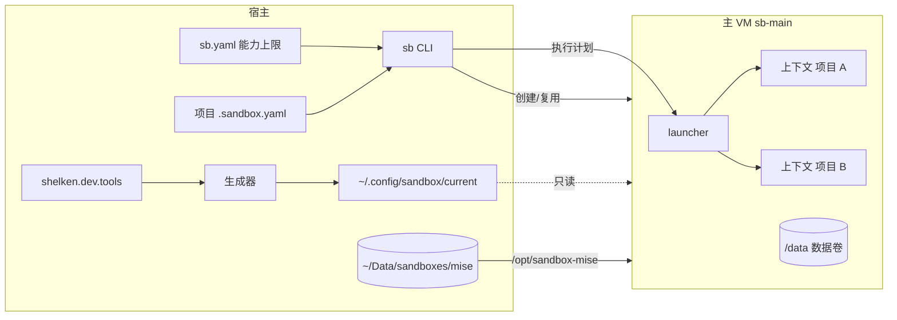
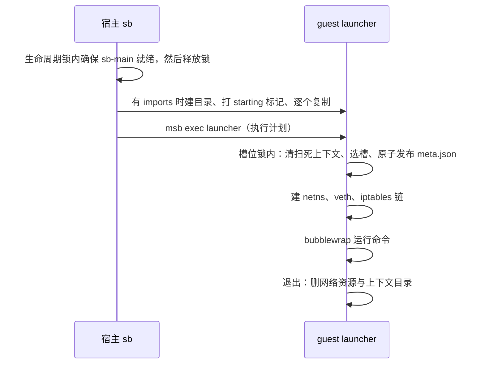

# Agent 沙箱

`sb` 与 `omp-sb` 让 Agent 在 Linux 虚拟机里运行，只看得到当前项目。本文讲机制；日常操作见 [用户指南](../../../../docs/user-guide/03-agent-sandbox.md)

威胁模型只防 Agent 误操作（越界删除、误连其他项目的私网服务），不防恶意逃逸。设计原因见文末「设计决策」；共享工具登记表的决策见 [ADR 0003](../../../../docs/adr/0003-shared-tool-single-declaration.md)

由 `shelken.dev.ai.sandbox.enable` 控制，默认关闭

## 架构



| 组件 | 文件 | 职责 |
| --- | --- | --- |
| 宿主 CLI | [sb.sh](./sb.sh)、[_sb.nix](./_sb.nix) | 读上限、解析项目计划、管理主 VM 生命周期、复制 imports、调用 launcher |
| launcher | [launcher.sh](./launcher.sh)、[_launcher.nix](./_launcher.nix) | 在 guest 内以 root 建网络与 bubblewrap 视图，运行命令，退出清理 |
| 生成器 | [_generator.nix](./_generator.nix)、[sync-guest.sh](./sync-guest.sh) | 由登记表生成 guest 环境、mise 配置、OMP 配置与 sync 脚本 |
| 状态查询 | [guest-status.sh](./guest-status.sh) | 列出缺失的 mise 工具，供 `sb status` 使用 |
| 能力上限 | [sb.yaml](./sb.yaml) | 部署到 `~/.config/sandbox/sb.yaml`，`SB_CONFIG` 可覆盖 |

## 术语与不变量

- **主 VM (Main VM)**: 长期运行的一台沙箱 VM，承载所有日常执行上下文。_避免_: 全局 VM、sb-default
- **执行上下文 (Execution Context)**: 一次 Agent 启动所见的受限环境，由当前项目、导入文件和获准的网络目标组成。同一项目可同时存在多个。_避免_: 会话、实例、槽位
- **能力上限 (Capability Ceiling)**: 一台沙箱 VM 创建时固定的挂载根、VM 级网络策略（公网、DNS、私网整体放开）和 secret 集合，只能通过重建 VM 改变
- **能力授权 (Capability Grant)**: 某个执行上下文实际获得的额外路径、导入文件和私网目标。额外路径是挂载根的子集；导入文件和私网目标没有上限，由批准决定
- **批准 (Approval)**: 用户用 `sb trust` 对项目 `.sandbox.yaml` 的规范化内容哈希做的记录。未批准或内容变了，启动直接报错
- **项目配置 (Project Config)**: 项目仓库根 `.sandbox.yaml`，请求导入文件、私网目标和额外目录；批准后才生效
- **沙箱基础环境 (Sandbox Base)**: 沙箱启动与隔离所需的 Linux 工具，由 sandbox 模块管理，不属于共享工具。不含 C 工具链，见「设计决策」
- **补齐 (Sync)**: 显式安装已登记但缺失的 mise 工具和插件。_避免_: 升级、更新
- **共用安装层 (Shared Install Layer)**: 宿主上由所有沙箱 VM 共用的一份 mise 安装产物与下载缓存。_避免_: 共享缓存、镜像卷
- **项目工具 (Project Tool)**: 项目自己的 mise 配置声明、不在登记表里的工具。在执行上下文内按需安装，落在共用安装层，所有项目与 VM 共用。_避免_: 本地工具、临时工具
- **声明配置 (Declared Config)**: Nix 定义、发布进沙箱的配置文件或目录，即共享工具登记表 `files` 里的条目。上下文内只读，不管插件想不想改它。_避免_: 配置（太泛）
- **运行状态 (Runtime State)**: 工具运行中产生或修改的文件，例如插件数据库、登录态、intercom 运行目录。可写，所有上下文共用，不写回宿主

不变量：

1. 启动执行上下文不得停止、替换或破坏其他已运行的执行上下文
2. 能力授权始终是能力上限的子集
3. 执行上下文内的进程不能改变自己的能力授权
4. 导入文件归宿主所有，执行上下文的修改不写回宿主
5. 工具的升级只由用户主动触发，补齐不改变已安装项
6. 登记工具只由 `sb sync` 在上下文外补齐；执行上下文可以写共用安装层，用来安装项目工具
7. 上限指纹只含 guest 侧挂载声明，不含宿主真实路径；宿主路径变化不触发 VM 重建
8. 项目配置未批准或批准后内容变了，不得启动执行上下文；批准只发生在宿主上
9. 声明配置由挂载强制只读，不靠约定；同目录里的运行状态照常可写
10. 运行中的上下文看到的声明配置是启动时的快照；新配置在新开的上下文生效

## 两层能力

**能力上限**在主 VM 创建时固定：挂载根、VM 级网络策略、secret 都写进 msb 配置，运行中改不了。**能力授权**在每次启动上下文时由 launcher 授予：额外路径受挂载根约束；导入文件和私网目标没有上限，由用户用 `sb trust` 批准

### 上限：`sb.yaml`

| 字段 | 默认 | 说明 |
| --- | --- | --- |
| `image` | `ubuntu` | VM 镜像 |
| `cpus` / `memory` | `4` / `8G` | VM 规格 |
| `volume.name` / `volume.size` | `sb-main-data` / `8G` | 挂到 `/data` 的 ext4 数据卷，不存在时自动创建 |
| `mount_roots` | 无 | 挂载根，支持 `~`、`${HOME}`；先解析符号链接，guest 内路径与宿主一致 |
| `network.allow` | `public`、`dns` | VM 级网络策略（msb 规则语法）：`public`、`dns`、`private`、`host:tcp:<端口>`。`private` 整体放开私网，逐项限制由上下文内的 iptables 链完成；改它会改变上限指纹、触发重建 |
| `network.default_grant` | 无 | 所有上下文默认放行的私网 `IP:端口`；不进 VM 配置，改了不触发重建 |
| `secrets` | 无 | `变量名: { allow: [域名或 IP], passthrough: [域名] }`，真实值只在 VM 创建与启动时由宿主 `sec-run` 注入（msb 在启动时读宿主环境变量），`exec`、`copy` 不注入，所以日常 `sb run` 不触发 `op run` 与 1Password 授权弹窗；`allow` 是替换真实值的目标，`passthrough` 是占位符原样放行的目标（当前全部为 `*`，原因见「网络与 secret」）；改它会改变上限指纹、触发重建 |

### 授权：项目 `.sandbox.yaml`

| 字段 | 校验 | 落地方式 |
| --- | --- | --- |
| `imports` | 每项写 `src` 与 `target`；`src` 必须是存在的宿主文件；`target` 以 `~/` 或 `/` 开头、不含 `..`、位于子目录内，且不在沙箱保留位置（系统目录、`/data`、`~/.omp`、`~/.agents`、`~/.pi`） | 宿主 `msb copy` 进 guest 的暂存目录，目标目录整体绑定为该暂存目录（目录形式，支持原子改名），退出删除，不写回 |
| `network` | 只接受 `IP` 或 `IP:端口` | 上下文专有 iptables 链里先于私网拒绝规则放行 |
| `paths` | 必须在 `mount_roots` 内 | 同路径绑定，`:ro` 或 `readonly: true` 为只读 |

此外两项自动授权：项目根（git 仓库根，不在仓库内时取当前目录）可写绑定；worktree 的 git common dir 不在项目内时自动加绑，它不在挂载根内则拒绝启动

**批准**：项目有 `.sandbox.yaml` 时，`sb run`、`sb shell`、`omp-sb` 要求它已批准，否则直接报错并提示 `sb trust`，不弹提示、不等待输入。`sb trust` 对规范化内容（键排序、去注释，只改格式或注释不失效）算 SHA-256，记入 `$MSB_HOME/approvals/<哈希>`。批准只看内容、不看路径，所以同一份文件在所有 worktree 里只批准一次；文件一变（包括被 Agent 修改）就要重新批准。`sb plan` 显示批准状态。记录在宿主上，沙箱里的 `sb` 被宿主命令桩拒绝，Agent 批准不了自己

## 执行上下文

每次 `sb run`、`sb shell`、`omp-sb` 新建一个上下文，流程：



- **视图**：bubblewrap 映射到 UID 1000，只读绑定 `/usr`、`/etc`、`/nix/store`、`/.msb/tls`（msb CA，`NODE_EXTRA_CA_CERTS` 指向这里，缺失时 OMP 的模型发现全部失败）、共用 mise 层与配置目录；可写绑定 `/data`、项目根、额外路径与 imports 的目标目录（该目录在上下文里只剩导入的文件）。`/run` 是 tmpfs，上下文看不到 `/run/sandbox/contexts` 里其他上下文的 imports。launcher 预先创建 `/data/xdg/*/omp`，OMP 只在这些目录存在时才把数据库放到 `/data`
- **网络**：每个槽位一个 `/30` 子网（`10.200.x.y`），独立 netns 与 veth，NAT 出口。地址池 64 个，即单台主 VM 最多 64 个并发上下文
- **并发**：清扫、选槽、发布 `meta.json` 在 guest 内一把 flock 下串行；网络资源按唯一槽位命名，不会互相覆盖。cleanup 删本进程槽位的网络资源与上下文目录；槽位在锁内按占用情况分配，同一槽位不会有两个存活 launcher
- **复制窗口**：宿主复制 imports 期间目录还没有 `meta.json`，靠 `starting` 标记保护：120 秒宽限内清扫跳过它，忙碌计数也算上它。复制失败或宿主中断时宿主删除该目录
- **残留清扫**：每次启动与忙碌判断都会清理 PID 已死的上下文（连同它登记的 netns、veth 与 iptables 链）。被硬杀进程留下的同名网络资源由下一个拿到该槽位的上下文在 `ip netns add` / `iptables -N` 之前就地清掉

## 网络与 secret

上下文专有链的规则顺序：

1. DNS（guest `/etc/resolv.conf` 中的 nameserver，53 端口）
2. `sb.yaml` 中的 `host:tcp:<端口>`
3. `network.default_grant` 与项目声明的私网目标
4. 拒绝 `10/8`、`172.16/12`、`192.168/16`、`100.64/10`、`169.254/16`
5. 其余公网放行（含 fake-ip 段 `198.18/15`）

FORWARD 默认 DROP。公网只在 VM 级控制，不做上下文级限制

secret 由 msb 在网络边界替换：guest 内只有 `$MSB_<名字>` 占位符，请求发往该 secret 的 `allow` 目标时才换成真实值，token 不落盘。GitHub 的 `git@github.com:` remote 在 guest 内改写为 HTTPS，配合 `GITHUB_TOKEN` 占位符认证；不共享宿主 SSH 私钥

占位符本身也会进入对话：Agent 读到含 `$MSB_<名字>` 的文件或文档、执行 `env` 时，它就留在上下文里，随后每一轮请求体都带着它发往模型服务。msb 对发往 `allow` 之外目标的占位符默认拦截并切断连接，客户端看到的是首字节前的 `ECONNRESET`，`usage` 全为 0。所以 `sb.yaml` 给每个 secret 设 `passthrough: ["*"]`：占位符原样发往任何目标，**凭据**不会泄露，真实值仍只替换给 `allow` 里的目标

这只保证连接不断，不保证占位符不外传：它是稳定的明文字符串，会随请求离开本机，被模型服务和中间方记录，模型也可能把它回显到输出。`passthrough` 生效后 msb 不再产生 `secret violation`，宿主 `runtime.log` 也就不能再用来发现占位符进了对话；要确认，在会话 jsonl 或 `~/Data/sandboxes/msb/sandboxes/sb-main/logs/exec.log` 里 grep `$MSB_`

### 已知局限

- **私网在 VM 级是放开的。** 只有执行上下文内的进程受上下文链约束；不在上下文里运行的 guest 进程（`sb sync` 里的 mise 与 `bun install`、`msb exec` 进入的 root 进程）也能连私网。威胁模型只防 Agent 误操作，Agent 始终在上下文内，所以接受
- **批准只覆盖 `.sandbox.yaml` 的内容。** `imports.src` 指向的宿主文件内容变了不需要重新批准；内容相同的 `.sandbox.yaml` 放在别处也视为已批准
- **`sb trust` 不逐项确认。** 它直接记录批准，批准前要自己先看 `sb plan` 的清单

## 主 VM 生命周期

`sb.yaml` 生成的 msb 配置做 SHA-256 得到上限指纹，只记在 VM label。指纹里的共用 mise 挂载被规范化为占位符，宿主路径不影响指纹

| 情况 | 行为 |
| --- | --- |
| VM 不存在 | 创建数据卷与 VM，自动执行一次 `sb sync` |
| 指纹一致 | 运行中直接复用，停止则启动 |
| 指纹不一致且空闲 | 删除并按新上限重建，数据卷保留 |
| 指纹不一致且有上下文在运行 | 报错并给出上下文数，不打断任何上下文，也不登记状态 |
| 指纹不一致且查询不到上下文数 | 报错并给出失败原因（退出码与 stderr），按忙处理，不重建 |

创建、启动、重建、停止、删除都在宿主生命周期锁（`$MSB_HOME/locks`）内进行；锁只在 VM 就绪前持有，不阻塞上下文并发。`sb rm` 有上下文在运行时拒绝，`--force` 强制

## 工具

### 共享工具登记表

`shelken.dev.tools.<名字>` 只登记宿主与沙箱都需要的工具，接口在 [dev/tools.nix](../../dev/tools.nix)：

| 字段 | 说明 |
| --- | --- |
| `package` | nixpkgs 属性名，默认取登记名；与 `mise` 互斥 |
| `mise` | mise 规格，版本字符串或属性集 |
| `files` | 随工具进沙箱的声明配置，宿主照常作为 `home.file`。这是 Nix 配置进沙箱的唯一入口，宿主与沙箱都从它派生 |
| `postInstall` | 宿主激活时与 `sb sync` 时各运行一次 |

条目在 [dev/tools-base.nix](../../dev/tools-base.nix)（rg、fd、jq、gh、node、python3、uv 走 Nix；prek 走 mise）与 [ai/tools.nix](../tools.nix)（omp、pi、codex、claude-code、bun，走 mise）。宿主独有的工具不登记

`agent-common` 不对应可执行程序，只放 omp 与 pi 共用的配置：`.agents/` 下的 skills 与模型提示词，以及不专属某个 harness 的插件配置（如 `.config/ponytail`、`.config/rpiv-web-tools`）

生成器把 Nix 条目合成 guest PATH（来自 `/nix/store` 只读挂载），把 mise 条目写成 `/run/sandbox-config/current/mise.toml`。`sb`、`just`、`spawn-subagent`、`computer-use` 等宿主控制命令在 guest PATH 里是同名桩，调用时以非零码退出并说明原因（[shelken.dev.sandbox.hostCommands](../../dev/tools.nix)）

### 共用 mise 安装层

mise 的安装目录与下载缓存放在宿主 `~/Data/sandboxes/mise/aarch64-linux`（`SB_MISE_HOST_DIR`，首次使用自动创建），挂到所有 VM 的 `/opt/sandbox-mise`，新 VM 不必重新下载。mise 的 state、shims 与用户层配置 `/data/mise/config.toml` 留在各 VM 数据卷

上下文对共用层可写，不设 `MISE_AUTO_INSTALL=0`：Agent 或用户在上下文里 `mise trust`、`mise install` 即可装项目工具，产物落在宿主目录，VM 重建后、其他 VM 的上下文里都直接复用。信任记录在数据卷 `/data/xdg/state/mise`，同一 VM 内跨上下文保留。launcher 设 `MISE_PREFER_OFFLINE=1` 而不是 `MISE_OFFLINE=1`：后者连安装下载也拒绝（实测 `offline mode is enabled`）；前者让已装的 `latest` 工具直接用本地版本，不再每次启动联网白等（实测 minio/mc 的版本列表约 14 MB，超过 mise 的超时）。`sb sync` 不在上下文里，不受影响

### `sb sync`

在 VM 内（不在上下文内）运行 [sync-guest.sh](./sync-guest.sh)：

- 跨 VM 的写锁：共用目录下的 `.sync.lock`
- `mise install` 只补缺，不升级、不删除；不区分 VM 忙闲
- 运行各工具的 `postInstall`，其中 OMP 插件按 [package.json](../omp/plugins/package.json) 执行：与清单、锁文件及已装目录一致时直接跳过，不一致时先装到暂存目录，装成功才把整个 `node_modules` 换成暂存结果（清单之外的条目因此消失），装失败时旧目录原样保留。私有依赖用 `GITHUB_TOKEN` 占位符认证，安装失败时 `sb sync` 以非零退出，原因见「设计决策」

## 配置与数据位置

| 内容 | 位置 |
| --- | --- |
| 发布给 guest 的配置 | 宿主 `~/.config/sandbox/current`（Nix store 链接），guest `/run/sandbox-config/current`；声明配置清单 `declared-paths` 与可写根清单 `writable-roots` 在同一版本目录 |
| OMP、pi 配置与 skills | 上下文内 `/root/.omp/agent`、`/root/.pi/agent`、`/root/.agents`，整体可写，落在数据卷 `/data/home/` 下，所有上下文共用；其中声明配置逐项只读挂载 |
| `.config/<X>` 声明配置 | 上下文内 `$XDG_CONFIG_HOME/<X>`（`/data/xdg/config/<X>`），只读挂载；沙箱里没有 `/root/.config` |
| OMP 数据、会话、插件 | `/data/xdg/*/omp`（插件在 `/data/xdg/data/omp/plugins`），所有上下文共用一份 |
| 其他运行状态（pi-fff 数据库、intercom 运行目录、插件自己的设置等） | 留在工具默认位置，例如 `/root/.pi/agent/fff`，落在可写根里，所有上下文共用 |
| msb 运行数据 | `~/Data/sandboxes/msb`（`MSB_HOME`），镜像缓存 `~/.cache/microsandbox` |

可写根由登记表 `shelken.dev.sandbox.writableRoots` 声明（omp、pi、skills 各自声明自己的根，相对 `$HOME`），经发布目录的 `writable-roots` 交给 launcher；launcher 自己不带任何路径，数据卷位置固定为 `/data/home/<相对根>`。新增或删除根只改 Nix。构建期 assertion 要求：根是 `$HOME` 下的相对路径、互不嵌套，且每个 `shelken.dev.tools.*.files` 目标落在某个根下或在 `.config/` 下。当前的对应：

| 上下文内路径 | 数据卷位置 | 用途 |
| --- | --- | --- |
| `/root/.omp/agent` | `/data/home/.omp/agent` | OMP 用户级配置目录：声明配置只读，其余（如自建 `hooks/`、`commands/`）可写 |
| `/root/.pi/agent` | `/data/home/.pi/agent` | pi 与 pi 插件的配置和运行状态：`fff/`、`intercom/`、`npm/`、`git/`、`sessions/` 等 |
| `/root/.agents` | `/data/home/.agents` | skills 与模型提示词，几乎全是声明配置 |
| `$XDG_CONFIG_HOME/<X>` | `/data/xdg/config/<X>` | 宿主 `~/.config/<X>` 的声明配置（ponytail、rpiv-web-tools），只读 |

配置发布后，复用中的 VM 新开的上下文即读到新配置，不改指纹，不触发重建。运行中的上下文继续读启动时的版本：发布脚本保留旧版本 7 天，只清理更早的。guest 不跟随宿主 live-edit 软链

上下文外（`sb sync`、`msb exec`）的 `/root/.omp/agent`、`/root/.pi/agent`、`/root/.agents` 是指向只读发布目录的符号链接（`sync-guest.sh` 按 `writable-roots` 逐项建立），看不到上下文里的可写根。上下文布局只由 launcher 负责，改它不改指纹

## 设计决策

每节记录为什么这样设计、考虑过的替代方案和代价。机制本身见上文各节

### 一台主 VM 承载所有执行上下文

日常习惯是多个 OMP 同时在不同项目运行。每个项目一台 VM，内存成本高、管理也更复杂；把整个 `~/Code` 可写挂载给一台 VM，Agent 又能误删其他项目。microsandbox 0.7.7 的挂载、网络规则和 secret 在 VM 创建时固定，运行中修改要重启，会打断同一 VM 内其他 OMP。复现：

```bash
msb modify --help
PROBE=x msb modify --secret PROBE@example.com --dry-run <sandbox>
```

所以只有一台主 VM，每次启动新建一个执行上下文，同项目可并存多个，启动新上下文不影响已运行的上下文。OMP 数据、工具和缓存在所有上下文内共用一份可写状态，与宿主多个 OMP 共用一份 XDG 数据的语义一致

考虑过的替代方案：

- **每个项目或每个 OMP 一台 VM**：并发 4 个时启动后宿主内存约 2.8 至 2.9 GB，比单 VM 多约 1.1 GB，还要管理多台 VM
- **单活动槽位，切换项目时替换 VM**：会打断其他项目正在运行的 OMP
- **私网项目使用单独 VM**：每个上下文独立网络命名空间已能在主 VM 内按项目精确放行私网目标
- **guest 内按 UID 过滤网络**：guest 内核缺少 iptables `owner` 匹配模块，做不到
- **VM 级挂载凭据目录**：新增目录要重建 VM；运行时复制不需要，并保证宿主文件不被写回
- **项目配置放宿主集中目录**：Agent 无法修改，但新项目要在另一处登记。现在 Agent 改仓库内的 `.sandbox.yaml`，下次启动前必须由用户重新批准

代价：

- launcher 是唯一的隔离执行者。launcher 缺陷或内核逃逸会暴露整个能力上限，所以上限必须是可接受的最坏情况
- 公网只在 VM 级控制，不做上下文级限制；按项目精确控制只覆盖私网目标
- 同一主 VM 内某个上下文耗尽内存，可能波及其他上下文
- 资源与隔离实测记录见 wiki 页面 `microsandbox-concurrency-resource-cost`

### 不做附加 VM、待升级登记和破坏性 sync

审查发现的问题大多集中在三处：附加 VM 的并发生命周期（同时首次进入、最后退出撞上新进入、各自数据盘与 shims）、主 VM 忙时的待升级登记、`sb sync` 的忙闲两套模式及其与生命周期的竞态。日常使用是多个项目、多个 Agent 同进同一台主 VM，这些机制都不在这条主路径上，所以不做：

- 不提供单项目专用 VM。所有执行上下文都在主 VM，隔离由执行上下文提供
- 能力上限变化时，主 VM 空闲则下一次启动自动重建；仍有执行上下文则报错并给出上下文数，不登记待升级
- 只用一把宿主生命周期锁，只包住「检查上限指纹、必要时重建、启动 VM」。不做宿主侧预约，忙闲只看 guest 内 launcher 的上下文登记
- `sb sync` 不区分忙闲，不重建插件依赖的下载缓存，因此不需要判断忙闲，也不需要生命周期锁
- `sb status` 只报告缺失的 mise 工具，不报告插件安装状态

代价：

- 主 VM 忙时，某项目需要超出当前上限的能力，只能等主 VM 空闲后重建
- `sb status` 不显示待升级，也不显示插件是否装全；插件结果只看 `sb sync` 输出
- 插件目录每次 `sb sync` 都与清单严格对齐，手装的插件会被删除；需要临时插件时改清单
- 改了 `sb.yaml` 且两个 Agent 在同一两秒内启动时，后启动的上下文可能在启动阶段被重建打断，重新启动即可
- 忙时 `sb sync` 可能在运行中的 OMP 底下更新插件文件；插件已加载进内存，风险低

### 项目授权由宿主侧批准决定，私网在 VM 级整体放开

最初 `sb.yaml` 的 `network.allow` 逐项列出项目可申请的私网 IP，并写进 msb 的 VM 配置。这带来两个问题：

1. 改授权就要重建主 VM，而重建要求没有 Agent 在运行，日常同时开着多个 Agent 时几乎总被挡住
2. 上限是全局的。一个 IP 放进 `allow` 后，任何项目的 `.sandbox.yaml` 都能申请，而它在仓库里，Agent 改了就在下次启动生效

实测 msb 的 `allow` 支持 `private` 目标组：只写 `public` 时，对内网 kube-apiserver 的明文 HTTP 请求被拒绝连接，加上 `private` 后收到应用层的 `400 Bad Request`。而每个执行上下文的 iptables 链本来就按源地址逐项限制私网目标（[launcher.sh](./launcher.sh)），VM 级逐项列 IP 是重复的一层。

所以 VM 级放开私网，逐项限制只由上下文内的 iptables 链完成；导入文件和私网目标不设上限，是否放行由 `sb trust` 的批准决定。`paths` 仍受 `mount_roots` 限制，因为挂载是 VM 级的，同样计入批准。批准记录在宿主上，Agent 批准不了自己

考虑过的替代方案：

- **保留逐项上限，只放宽重建条件**：不改变信任模型，Agent 改文件仍然自动扩权
- **批准按路径加哈希**：同一份文件在每个 worktree 里都要重新批准，没有收益
- **交互式提示**：在后台、脚本、自动开 Agent 的场景会卡住
- **宿主侧项目授权文件（不进仓库）**：原本为公开仓库不能写内网 IP 设计，核实后仓库已大量包含内网 IP，这个理由不成立，需要时再加

代价：

- 改授权（新增一个 IP、换一个导入文件）不再触发 VM 重建，也不被运行中的 Agent 挡住
- 批准不覆盖 `imports.src` 指向的宿主文件的内容变化
- 改 `network.allow` 的 VM 级策略仍会改变上限指纹、触发一次重建
- 不在上下文里运行的 guest 进程也能连私网，见「已知局限」

### 默认放行模型服务的私网端口

家里的模型服务（`cpa.int.ooooo.space`、`commandcode.int.ooooo.space`）都解析到私网 `192.168.69.46`。执行上下文默认拒绝全部私网，每个项目都要在 `.sandbox.yaml` 声明这个 IP，OMP 才能调用模型；不声明时默认模型请求反复重试，表现为卡住。模型服务是每个 Agent 都要用的基础依赖，不属于某个项目

所以 `sb.yaml` 的 `network.default_grant` 列出所有上下文默认放行的私网目标，只接受 `IP:端口`，当前只放行 `192.168.69.46:443`。范围按端口收窄，同一台机器的其他端口仍需项目声明。它是上下文级授权，不写进 VM 配置、不改变上限指纹，修改后下一个新上下文即生效

考虑过的替代方案：

- **按 IP 整体默认放行**：配置更简单，但所有项目都能访问该机器上的全部服务
- **保持每个项目声明**：不改代码，但每个新项目都要先写 `.sandbox.yaml` 才能用 OMP

### 导入文件按目标目录绑定

原来 `imports` 只能把文件放到上下文内的 `/imports/<文件名>`。home-ops 这类项目用 mise 把 `KUBECONFIG` 固定为 `$HOME/.kube/home-ops.yaml`，工具只认这个路径，所以没法用

所以每项写 `src` 与 `target`。同一目标目录的导入共用一个暂存目录，launcher 把它整体绑定到该目录，不做单文件绑定，否则上下文内的原子改名会报 `Device or resource busy`（实测）。保留位置不能做目标目录：家目录本身、`/`、系统目录、`/data`、`/run`、`/.msb`，以及 launcher 铺设 agent 配置目录的 `~/.omp`、`~/.agents`、`~/.pi`；同一个 `target` 不能重复。导入文件在上下文内只对上下文用户可读写（`600`）

不做：

- OAuth 登录态不导入。OMP 的登录态在 `agent.db`，位于共享的 `/data/xdg/data/omp`，在沙箱里登录一次即可持久化并被所有项目共用
- 不写回宿主。上下文内的修改随上下文退出丢弃

考虑过的替代方案：

- **单文件绑定**：目录遮蔽的副作用消失，但原子改名失败
- **把凭据放进 `/data` 持久化**：`/data` 绑进所有上下文，项目凭据会对其他项目可见

代价：目标目录在上下文里只剩导入的文件

### agent 配置目录整体可写，声明配置逐项只读

原来 `/root/.omp/agent`、`/root/.pi`、`/root/.agents` 是指向只读发布目录的符号链接，整个目录只读。凡是把状态写在配置目录旁边的插件都会失败：pi-fff 建不了数据库（`Failed to create directory: Read-only file system`），pi-intercom 建不了 `~/.pi/agent/intercom` 运行目录，插件自己的设置文件也写不进去

现在和宿主一致：三个目录是数据卷上的可写根，所有上下文共用；Nix 定义的路径按来源判断，逐项 `--ro-bind` 到上面：

- 挂载单元就是发布清单的每一项：文件项绑文件，目录项（如 `.agents/skills/<名>`、`.omp/agent/agents`）绑整个目录。同目录里别人放的文件可写，`extensions/` 这类目录因此可以混放
- launcher 只解析一次 `current`，清单与挂载源来自同一版本目录；源缺失直接报错并指出路径，不跳过
- 嵌套声明项的祖先目录（如 `extensions/`、`intercom/`、`/data/xdg/config/<X>`），以及 `/root` 和各根的上层目录（由 `writable-roots` 推出，如 `/root/.omp`、`/root/.pi`），也都做成挂载点。内核只拒绝改名挂载点本身，改名普通祖先会把下面的只读挂载一起移走，原位置就能建出可写的同名替身（实测，经上下文路径或 `/data` 后备路径都成立）。做成挂载点后改名一律 `Device or resource busy`。`imports` 的目标也不得落在这些挂载点或根下，同样由清单推出
- 挂载点在数据卷上留下空文件或空目录占位。声明从文件改成目录（或反过来）时，旧占位会让 bwrap 报 `Destination is not a file` 而起不来。launcher 在启动锁内检查：类型不符的空占位，没有别的上下文在运行时删除；有别的上下文时报错，占位是它们的挂载点，类型要变就等全部退出后再整理；非空内容一律报错，不自动删，里面可能是别的上下文的运行状态
- 发布脚本保留旧版本 7 天。挂载钉住启动时的版本目录，立即删除旧版本会让运行中的上下文读不到复制来的条目（live-edit 主机上的 `settings.json`、`AGENTS.md` 等，实测）

考虑过的替代方案：

- **整目录只读**：即原来的做法，插件写状态全部失败
- **符号链接农场**：可写目录里逐项链接到发布目录。插件 unlink 或原子替换就能把链接换成普通文件，只读只是约定
- **根的清单写在 launcher 里**：同一份知识在 Nix 与 shell 各有一份，还要在 tmpfs 挂载点、`imports` 保留位置、`sync-guest.sh` 里各抄一遍，新增根时漏一处就留下可改名的祖先目录
- **从 `files` 目标路径推断根**：`.agents/x`、`.omp/agent/x`、`.config/x` 的根深度不一致，只能把规则硬编码，等于换个地方写死
- **持久化整个 HOME**：最省事，但 `/root` 其余部分也会跨上下文共用，`.sandbox.yaml` 的 `imports` 隔离失效

代价：

- 每次启动多约 180 个挂载，实测启动多 35ms 左右
- 可写区里新建的 `hooks/`、`tools/`、`SYSTEM.md`、`RULES.md`、`commands/`、`rules/` 会对之后所有项目生效（OMP 从这些位置自动加载），不预留占位
- 沙箱里的运行状态与宿主分开：`auth.json`、`agent.db` 等不从宿主导入，在沙箱里登录一次后留在数据卷共用；旧数据卷上的状态不迁移，新位置从空开始
- 宿主 `just hm` 后，运行中的上下文仍是旧配置，重开上下文才生效

已知局限：经 `/data` 后备路径可以把可写根本身改名（如 `mv /data/home/.pi /data/home/.pi-gone`）。声明配置的挂载钉着原目录，上下文视图不变，下次启动 launcher 重新建可写根，所以不是绕过；但数据卷上会留下改名后的孤儿目录。不做自动清理，无法区分用户故意改名与残留

### pi 在上下文里自己装 packages

pi 启动时按 `settings.json` 的 `packages` 检查已装的包，缺什么就当场装：npm 源装到 `~/.pi/agent/npm`，git 源 clone 到 `~/.pi/agent/git/<host>/<path>`，再装依赖；已装好的第二次启动不再安装。沙箱清单排除依赖 `node-pty` 的 `@shelken/simple-plannotator`，其余扩展按清单安装。

所以：

- 沙箱里的 `settings.json` 由 Nix 生成，去掉 `sandboxExclude` 列出的 packages 和该字段本身；宿主继续使用仓库配置
- 包落在可写根里，属于运行状态，所有上下文共用。不变量 6 管的是共用 mise 安装层，不涉及这里
- `pi-dynamic-models` 的开关（`~/.pi/agent/extensions/pi-dynamic-models/config.json`）由 Nix 声明。cpa、mp 等 provider 在 `models.json` 里没有模型，只靠它向网关发现

考虑过的替代方案：

- **在 `sb sync` 里装**：sync 在上下文外，看到的 `~/.pi/agent` 是只读发布目录，要么复刻 launcher 的挂载视图，要么照抄 pi 的安装布局；而且 pi 启动时缺包仍会自己装
- **`PI_OFFLINE=1` 跳过装包**：同时关掉模型发现，cpa 等 provider 的模型全部找不到
- **只对 pi 的 bun 忽略安装脚本**：需要原生模块的包可能装好却无法加载。沙箱直接排除需要现场编译的插件，其余包照常执行安装脚本

代价：

- 新数据卷上 pi 首启要安装清单中的 packages，耗时取决于网络和缓存；之后复用已安装的包
- cpa、mp 在 `models.json` 里只有 `modelOverrides`，没有 `models`，所以只能靠发现；不把 `modelOverrides` 静态化成 `models`（会让约 50 个模型退化成 128k/16k/仅文本，宿主也受影响）。`pi-dynamic-models` 对没有缓存的 provider 在会话开始前发现一次，所以新数据卷上 `pi -p --model cpa/…` 第一次就能解析模型；实测清空 `~/.pi/agent/cache` 后一次成功

已知限制，根因未查，也没有加 timeout、重试等绕过：

- **同时首启多个 pi 可能失败。** 没有复核，原因没有查。新数据卷上先单独启动一个 pi、等装完，再并发使用；装完之后的并发没有单独验证

### 共用 mise 安装层

主 VM 数据盘坏掉重建、一次性 e2e VM 启动时，mise 工具（bun、codex、oh-my-pi 等）和 OMP 插件都要重新下载安装，下载量大、耗时长。另外，若把宿主真实路径直接写进 VM 挂载配置，路径变化（如用户名、目录调整）会改变上限指纹，让复用中的 VM 被判定「上限不一致」而重建

所以：

- 宿主只有一个共用目录，取真实物理路径（非符号链接）；msb 解析符号链接后仍指向同一目录
- 所有 VM 一律把它挂到 `/opt/sandbox-mise`。上限指纹只含 guest 侧声明 `/opt/sandbox-mise:rw`，不含宿主真实路径，宿主路径变化不触发重建
- 共用的只有安装产物与下载缓存；mise 的 `state`、`shims` 与可写用户层配置仍归各 VM 数据盘
- guest 环境变量只有一个来源 `/run/sandbox-config/current/guest-env.sh`，由生成器生成，`sb sync`、执行上下文、`guest-status.sh` 统一 source
- `sb sync` 在宿主侧经 flock（共用目录下的 `.sync.lock`）串行化，多 VM 并发 sync 不交叉写安装层
- sync 不清理下载缓存，共用的下载缓存是资产
- 主 VM 首次创建后自动 sync 一次；`sb run`、`sb shell`、`omp-sb` 复用已有 VM 时不自动 sync
- 执行上下文可写共用层，项目工具在上下文内用 `mise install` 安装，不经 `sb sync`、不需要登记。原先上下文只读、安装只走 `sb sync`，目的是让 sync 成为唯一写入方；但威胁模型只防误操作，Agent 本来就能在项目里下载并运行任意程序，只读挡不住什么，反而让项目 `mise.toml` 里的工具（kustomize、helm、flux 等）在沙箱里无法使用。上下文的安装不拿 `.sync.lock`，并发安装同一版本由 mise 自己串行（实测 3 个上下文同时装 `shfmt@3.10.0`，1 个安装、2 个报告已安装，三者都能运行）
- OMP 插件在 guest 内每次按沙箱清单重建。先把可写清单副本和旧 `bun.lock` 放入同级暂存目录，再使用保留的 Bun 缓存安装。安装成功后备份整个旧插件目录，再替换为新目录；清单外插件和旧登记表随旧目录删除。替换失败时恢复旧目录。私有依赖的 `git+ssh://git@github.com/…` 与 `ssh://git@github.com/…` 在本次安装中都改走 https（两条 `insteadOf`）。安装脚本通过 `gh auth token` 读取当前登录态，只向本次 Bun 安装传入 `GITHUB_TOKEN`；避免 Bun 把 SSH 用户名 `git` 带入 HTTPS 认证后被 credential helper 拒绝。guest 读到的是占位符，msb 在网络边界替换；宿主从现有 gh 登录态读取，同样不用 ssh
- 宿主与沙箱要装不同的插件时，在清单顶层写 `sandboxExclude`：列出的依赖只从沙箱清单里去掉，宿主清单不变。沙箱清单由 Nix 在构建期生成（`sandboxFiles`）。`guest-env.sh` 导出 `SB_OMP_MANIFEST`，共享工具的安装命令把该路径传给 `install.sh`；宿主未设置时使用仓库原件。排除项不在 `dependencies` 里时构建失败
- 安装或替换失败时 `sb sync` 以非零退出，宿主激活只打警告。替换前的备份包含插件、清单、锁文件和登记表；自动恢复也失败时输出备份路径并保留备份。缓存缺少所需内容时 Bun 可以联网下载
- 宿主 Home Manager 激活会重置 PATH。`postInstall` 先加入登记表中的 Nix 工具，再加入 mise shims；Node 等 Nix 运行时不会被未配置版本的旧 mise shim 遮蔽。Bun 继续由 mise 提供
- 依赖的安装脚本照常执行。沙箱基础环境不带 C 工具链，没有 linux 预编译产物的原生依赖装不上，这是刻意的取舍：唯一需要它的 `simple-plannotator`（依赖 `node-pty`）已从沙箱插件清单排除，宿主仍保留。实测省下约 331 MiB 闭包

代价：

- 共用安装层损坏影响所有 VM，用 `sb sync` 重装自愈
- 宿主目录体积随工具增长（约 1 至 2 GB 量级）
- 沙箱里装不了需要现场编译的原生依赖（如 `node-pty`），负对照见 `ae7b2b5d` 的验证记录
- 没有有效 GitHub 凭据时私有插件装不上，`sb sync` 失败
- 上下文里的 `mise uninstall`、`mise prune` 会删掉所有 VM 共用的版本；登记工具用 `sb sync` 补回，项目工具再 `mise install`
- 没有 mise shell 激活，命令找不到时不会自动安装；新工具要先 `mise install`（安装会生成 shim）
- 需要现场编译的项目工具装不上，例如依赖原生扩展的 `pipx:` 包（实测 `pipx:homeassistant-cli` 报 `No such file or directory: 'gcc'`）

## 测试

[e2e/smoke.sh](./e2e/smoke.sh) 在一次性 `MSB_HOME` 中启动临时 VM，断言三项隔离边界：相邻项目不可见、未声明私网无应用层响应、worktree 内可提交

```bash
bash modules/features/ai/sandbox/e2e/smoke.sh
```

需要宿主有 `msb`、ubuntu 镜像缓存、能访问公网与 Linux 构建器；默认现场构建 `sb`，可用 `SB_BIN` 指定。首次创建 VM 会自动执行一次 `sb sync`；冒烟测试的发布目录里没有 `sync-guest.sh`，那次 sync 在 guest 内直接跳过，共用 mise 层只被挂载、不被写入

冒烟测试之外的行为验证（首次启动、OMP 调模型、sync、生命周期与授权）见项目技能 [verify-sandbox](../../../../.agents/skills/verify-sandbox/SKILL.md)
