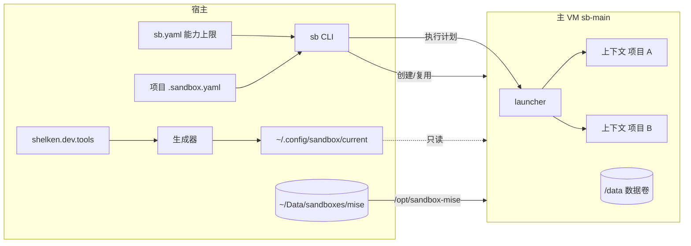
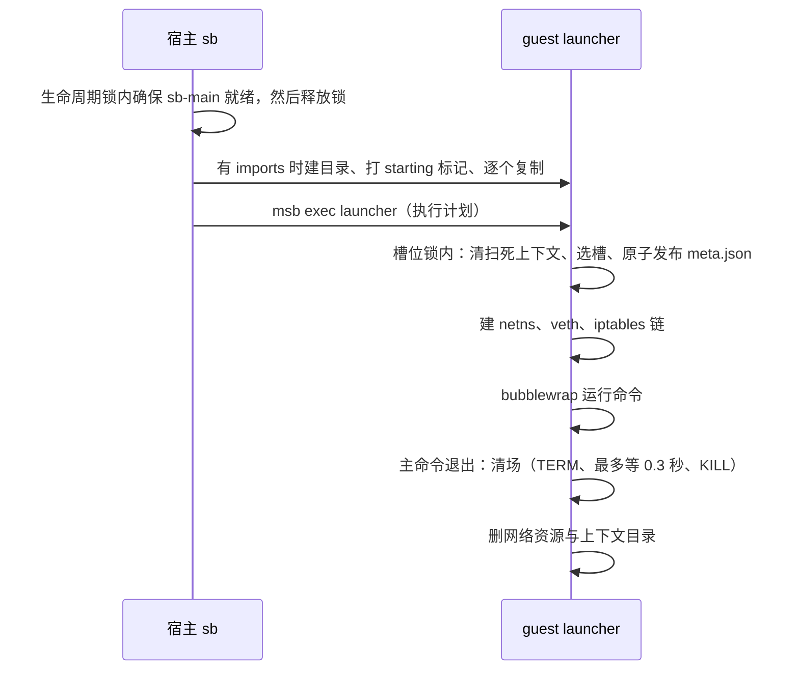

# Agent 沙箱

`sb` 与 `omp-sb`、`pi-sb` 等 harness 命令让 Agent 在 Linux 虚拟机里运行，只看得到当前项目。本文讲机制；日常操作见 [用户指南](../../../../docs/user-guide/03-agent-sandbox.md)

威胁模型只防 Agent 误操作（越界删除、误连其他项目的私网服务），不防恶意逃逸。设计原因见文末「设计决策」；共享工具登记表的决策见 [ADR 0003](../../../../docs/adr/0003-shared-tool-single-declaration.md)

由 `shelken.dev.ai.sandbox.enable` 控制，默认关闭

## 架构



| 组件 | 文件 | 职责 |
| --- | --- | --- |
| 装配 | [default.nix](./default.nix)、[_manifest.nix](./_manifest.nix) | `default.nix` 装配三个深模块并暴露 HM 选项；`_manifest.nix` 是宿主路径、guest 固定路径、声明文件落点与断言的单一事实来源 |
| 共用 mise 层 | [_mise-layer.nix](./_mise-layer.nix) | 宿主目录、guest 挂载点、上下文环境的唯一定义，shell 里没有内置默认值 |
| 配置物化 | [_config.nix](./_config.nix) | 收集声明文件，原子发布到 `~/.config/sandbox/current` 并修剪过期版本 |
| Guest 运行时 | [_guest.nix](./_guest.nix)、[launcher.sh](./launcher.sh)、[guest/](./guest/)、[sync-guest.sh](./sync-guest.sh)、[guest-status.sh](./guest-status.sh) | Linux 工具闭包、`guest-env.sh`（guest 里固定路径与环境的唯一出处）与 bubblewrap 隔离执行器；`guest/` 含 plan、netns、registry、layout |
| 宿主 CLI | [_host.nix](./_host.nix)、[py/sb/](./py/sb/) | `_host.nix` 生成 msb 配置与 `sb-config.json`（Nix 到 sb 的唯一配置通道）并打包 `sb`，以及登记表里每个声明了 `sandboxCommand` 的 harness 的 `<名>-sb`（`omp-sb`、`pi-sb`），它们等价于 `sb run <名> "$@"`；`py/sb` 是 CLI 本体：`ceiling.py` 把 `sb.yaml` 解析成带类型的能力上限，`msb.py` 是 msb 命令行的唯一 seam |
| 能力上限 | [sb.yaml](./sb.yaml) | 原生 YAML 策略基线，经 `sb-config.json` 的 `policy_yaml` 指向 Nix store 里的这份 |

## 术语与不变量

- **主 VM (Main VM)**: 长期运行的一台沙箱 VM，承载所有日常执行上下文。_避免_: 全局 VM、sb-default
- **执行上下文 (Execution Context)**: 一次 Agent 启动所见的受限环境，由当前项目、导入文件和获准的网络目标组成。同一项目可同时存在多个。_避免_: 会话、实例、槽位
- **能力上限 (Capability Ceiling)**: 一台沙箱 VM 创建时固定的挂载根、VM 级网络策略（公网、DNS、私网整体放开）和 secret 集合，只能通过重建 VM 改变
- **能力授权 (Capability Grant)**: 某个执行上下文实际获得的额外路径、导入文件和私网目标。额外路径是挂载根的子集；导入文件和私网目标没有上限，由批准决定
- **批准 (Approval)**: 用户用 `sb trust` 对项目 `.sandbox.yaml` 的规范化内容哈希做的记录。未批准或内容变了，启动直接报错
- **项目配置 (Project Config)**: 项目仓库根 `.sandbox.yaml`，请求导入文件、私网目标和额外路径；批准后才生效
- **执行计划 (Plan)**: `sb` 解析、校验能力上限与项目配置后交给 launcher 的数据，host → guest 的唯一契约。类型在 [py/sb/plan.py](./py/sb/plan.py)，guest 里只有 [guest/plan.sh](./guest/plan.sh) 解析它，改字段要同步两处，[py/test_contract.py](./py/test_contract.py) 校验两边一致。_避免_: plan_json（那只是它的序列化）
- **发布目录 (Published Config)**: `~/.config/sandbox/current` 指向的版本化目录，只读挂进 VM 的 `/run/sandbox-config`，含声明配置副本、`mise.toml`、`guest-env.sh`、`declared-paths`、`writable-roots`。旧版本保留 7 天
- **沙箱基础环境 (Sandbox Base)**: 沙箱启动与隔离所需的 Linux 工具，由 sandbox 模块管理，不属于共享工具。不含 C 工具链，见「设计决策」
- **补齐 (Sync)**: 显式安装已登记但缺失的 mise 工具和插件。_避免_: 升级、更新
- **共用安装层 (Shared Install Layer)**: 宿主上由所有沙箱 VM 共用的一份 mise 安装产物与下载缓存。_避免_: 共享缓存、镜像卷
- **项目工具 (Project Tool)**: 项目自己的 mise 配置声明、不在登记表里的工具。在执行上下文内按需安装，落在共用安装层，所有项目与 VM 共用。_避免_: 本地工具、临时工具
- **声明配置 (Declared Config)**: Nix 定义、发布进沙箱的配置文件或目录，即共享工具登记表 `files` 里的条目。上下文内只读，不管插件想不想改它。_避免_: 配置（太泛）
- **运行状态 (Runtime State)**: 工具运行中产生或修改的文件，例如插件数据库、登录态、intercom 运行目录。可写，所有上下文共用，不写回宿主

不变量：

1. 启动执行上下文不得停止、替换或破坏其他已运行的执行上下文
2. 能力授权始终是能力上限的子集
3. 执行上下文内的进程不能改变自己的能力授权
4. 导入文件归宿主所有，执行上下文的修改不写回宿主
5. 工具的升级只由用户主动触发，补齐不改变已安装项
6. 登记工具只由 `sb sync` 在上下文外补齐；执行上下文可以写共用安装层，用来安装项目工具
7. 上限指纹只含 guest 侧挂载声明，不含宿主真实路径；宿主路径变化不触发 VM 重建
8. 项目配置未批准或批准后内容变了，不得启动执行上下文；批准只发生在宿主上
9. 声明配置由挂载强制只读，不靠约定；同目录里的运行状态照常可写
10. 运行中的上下文看到的声明配置是启动时的快照；新配置在新开的上下文生效

## 两层能力

**能力上限**在主 VM 创建时固定：挂载根、VM 级网络策略、secret、空闲超时都写进 msb 配置，运行中改不了。**能力授权**在每次启动上下文时由 launcher 授予：额外路径受挂载根约束；导入文件和私网目标没有上限，由用户用 `sb trust` 批准

### 上限：`sb.yaml`

| 字段 | 默认 | 说明 |
| --- | --- | --- |
| `image` | `ubuntu` | VM 镜像 |
| `cpus` / `memory` | `4` / `8G` | VM 规格 |
| `volume.name` / `volume.size` | `sb-main-data` / `8G` | 挂到 `/data` 的 ext4 数据卷，不存在时自动创建 |
| `idle_timeout` | 无 | `30s`、`5m`、`1h` 这样的时长。没有活跃的 `msb exec` 会话超过该时长，msb 自动停止主 VM，下次 `sb run`、`<名>-sb` 自动启动，不用记得 `sb down`。每个执行上下文就是一个附着会话，上下文里 `nohup` 的后台进程不算活跃，会随 VM 停掉；`sb status` 会执行一次 `msb exec`，重置计时。msb 只在创建时应用它，所以改它会改变上限指纹：空闲时下次启动重建，有上下文在运行时报错 |
| `mount_roots` | 无 | 挂载根，支持 `~`、`${HOME}`；先解析符号链接，guest 内路径与宿主一致 |
| `network.allow` | `public`、`dns` | VM 级网络策略（msb 规则语法）：`public`、`dns`、`private`、`host:tcp:<端口>`。`private` 整体放开私网，逐项限制由上下文内的 iptables 链完成；改它会改变上限指纹、触发重建 |
| `network.default_grant` | 无 | 所有上下文默认放行的私网 `IP:端口`；不进 VM 配置，改了不触发重建 |
| `secrets` | 无 | `变量名: { allow: [域名或 IP], passthrough: [域名] }`，真实值只在 VM 创建与启动时由 `sb` 交给 msb（msb 在启动时读宿主环境变量）：一部分来自宿主 `sec-run` 的环境，用户本人的 `GITHUB_TOKEN` 由 `sb` 直接读 sops 文件，不进入宿主上其他程序的环境；`exec`、`copy` 不注入，所以日常 `sb run` 不触发 `op run`；`allow` 是替换真实值的目标，`passthrough` 是占位符原样放行的目标（当前全部为 `*`，原因见「网络与 secret」）；改它会改变上限指纹、触发重建 |

### 授权：项目 `.sandbox.yaml`

| 字段 | 校验 | 落地方式 |
| --- | --- | --- |
| `imports` | 每项写 `src` 与 `target`；`src` 必须是存在的宿主文件；`target` 以 `~/` 或 `/` 开头、不含 `..`、位于子目录内，且不在沙箱保留位置（系统目录、`/data`、`~/.omp`、`~/.agents`、`~/.pi`） | 宿主 `msb copy` 进 guest 的暂存目录，目标目录整体绑定为该暂存目录（目录形式，支持原子改名），退出删除，不写回 |
| `network` | 只接受 `IP` 或 `IP:端口` | 上下文专有 iptables 链里先于私网拒绝规则放行 |
| `paths` | 必须在 `mount_roots` 内 | 同路径绑定，`:ro` 或 `readonly: true` 为只读 |

字段类型写错（如 `network` 写成字符串而不是列表）直接报错，不会被当作没写。此外两项自动授权：项目根（git 仓库根，不在仓库内时取当前目录）可写绑定；worktree 的 git common dir 不在项目内时自动加绑，它不在挂载根内则拒绝启动

**批准**：项目有 `.sandbox.yaml` 时，`sb run`、`sb shell`、`<名>-sb` 要求它已批准，否则报错并提示 `sb trust`，不弹提示。`sb trust` 对规范化内容（键排序、去注释）算 SHA-256，记入 `$MSB_HOME/approvals/<哈希>`；只看内容、不看路径，同一份文件在所有 worktree 里只批准一次，文件一变（含被 Agent 修改）要重新批准。记录在宿主上，沙箱里的 `sb` 被宿主命令桩拒绝，Agent 批准不了自己

## 执行上下文

每次 `sb run`、`sb shell`、`<名>-sb` 新建一个上下文，流程：



- **视图**：bubblewrap 映射到 UID 1000。只读：`/usr`、`/etc`、`/nix/store`、`/.msb/tls`（msb CA，缺失时 OMP 的模型发现全部失败）、发布目录；可写：`/data`、共用 mise 层（见「共用 mise 安装层」）、项目根、额外路径、imports 的目标目录（在上下文里只剩导入的文件）。`/run` 是 tmpfs，看不到其他上下文的 imports
- **网络**：每个槽位一个 `/30` 子网（`10.200.x.y`），独立 netns 与 veth，NAT 出口；地址池 64 个，即最多 64 个并发上下文
- **清场**：主命令一退出，上下文里残留的进程（工具 detach 的后台守护）先收 TERM，等到只剩 PID 1 与清场进程或超过 0.3 秒，再收 KILL。bubblewrap 的 PID 1 会等命名空间里所有进程退出，不清场的话守护会拖住退出（pi-intercom 的 broker 在最后一个客户端离开后还要等 5 秒）。每个上下文各有 PID 命名空间，清场不影响其他上下文；上下文之间共享数据盘上的 socket 目录，本上下文拉起的守护被清掉后，其他上下文的客户端会自行重连并重新拉起
- **并发**：清扫、选槽、发布 `meta.json` 在 guest 内一把 flock 下串行，网络资源按槽位命名，不会互相覆盖
- **复制窗口**：宿主复制 imports 期间目录还没有 `meta.json`，靠 `starting` 标记保护（120 秒内清扫跳过它，忙碌计数算上它）；复制失败或中断时宿主删除该目录
- **残留清扫**：每次启动与忙碌判断都清理 PID 已死的上下文及其网络资源；被硬杀留下的同名资源由下一个拿到该槽位的上下文就地清掉

## 网络与 secret

上下文专有链的规则顺序：

1. DNS（guest `/etc/resolv.conf` 中的 nameserver，53 端口）
2. `sb.yaml` 中的 `host:tcp:<端口>`
3. `network.default_grant` 与项目声明的私网目标
4. 拒绝 `10/8`、`172.16/12`、`192.168/16`、`100.64/10`、`169.254/16`
5. 其余公网放行（含 fake-ip 段 `198.18/15`）

FORWARD 默认 DROP。公网只在 VM 级控制，不做上下文级限制

secret 由 msb 在网络边界替换：guest 内只有 `$MSB_<名字>` 占位符，请求发往该 secret 的 `allow` 目标时才换成真实值，token 不落盘。GitHub 的 `git@github.com:` remote 在 guest 内改写为 HTTPS，配合 `GITHUB_TOKEN` 占位符认证；不共享宿主 SSH 私钥

占位符会随对话进入请求体。msb 对发往 `allow` 之外目标的占位符默认拦截并切断连接（客户端看到首字节前的 `ECONNRESET`），所以 `sb.yaml` 给每个 secret 设 `passthrough: ["*"]`：占位符原样放行，真实值仍只替换给 `allow` 里的目标

这只保证连接不断，不保证占位符不外传：它是稳定的明文字符串，会被模型服务和中间方记录，模型也可能回显。`passthrough` 生效后 msb 不再产生 `secret violation`，要确认占位符是否进了对话，在会话 jsonl 或 guest 的 `exec.log` 里 grep `$MSB_`

### 已知局限

- **私网在 VM 级是放开的。** 不在上下文里运行的 guest 进程（`sb sync` 里的 mise 与 `bun install`、`msb exec` 进入的 root 进程）也能连私网。Agent 始终在上下文内，威胁模型只防误操作，所以接受
- **批准只覆盖 `.sandbox.yaml` 的内容。** `imports.src` 指向的宿主文件内容变了不需要重新批准；内容相同的 `.sandbox.yaml` 放在别处也视为已批准
- **`sb trust` 不逐项确认。** 批准前要自己先看 `sb plan` 的清单

## 主 VM 生命周期

`sb.yaml` 生成的 msb 配置做 SHA-256 得到上限指纹，只记在 VM label。指纹里的共用 mise 挂载被规范化为占位符，宿主路径不影响指纹

| 情况 | 行为 |
| --- | --- |
| VM 不存在 | 创建数据卷与 VM，自动执行一次 `sb sync` |
| 指纹一致 | 运行中直接复用，停止则启动 |
| 指纹不一致且空闲 | 删除并按新上限重建，数据卷保留 |
| 指纹不一致且有上下文在运行 | 报错并给出上下文数，不打断任何上下文，也不登记状态 |
| 指纹不一致且查询不到上下文数 | 报错并给出失败原因（退出码与 stderr），按忙处理，不重建 |

创建、启动、重建、停止、删除都在宿主生命周期锁（`$MSB_HOME/locks`）内进行；锁只在 VM 就绪前持有，不阻塞上下文并发。`sb rm` 有上下文在运行时拒绝，`--force` 强制

## 工具

### 共享工具登记表

`shelken.dev.tools.<名字>` 只登记宿主与沙箱都需要的工具，接口在 [dev/tools.nix](../../dev/tools.nix)：

| 字段 | 说明 |
| --- | --- |
| `package` | nixpkgs 属性名，默认取登记名；与 `mise` 互斥 |
| `mise` | mise 规格，版本字符串或属性集 |
| `files` | 随工具进沙箱的声明配置，宿主照常作为 `home.file`。这是 Nix 配置进沙箱的唯一入口，宿主与沙箱都从它派生 |
| `sandboxFiles` | 同一文件在沙箱里的替代内容，按目标路径覆盖 `files` 的同名条目 |
| `env` | 宿主与沙箱都要的环境变量：宿主合入 `home.sessionVariables`，沙箱写进 `guest-env.sh`。沙箱不继承宿主 shell 的环境，插件读的变量只写在宿主就进不了沙箱 |
| `sandboxEnv` | 只有沙箱要的环境变量，写进 `guest-env.sh`；值可引用 `SB_CONFIG_DIR` 等 guest 变量 |
| `sandboxDirs` | 沙箱内必须预先存在的目录（例如 OMP 只在 `$XDG_DATA_HOME/omp` 存在时才把插件放进 XDG 目录） |
| `sandboxCommand` | harness 在沙箱内的可执行名（omp、pi）；宿主据此生成 `<可执行名>-sb`，不写则不生成 |
| `postInstall` | 宿主激活时与 `sb sync` 时各运行一次 |

条目在 [dev/tools-base.nix](../../dev/tools-base.nix)（rg、fd、jq、gh、node、python3、uv 走 Nix；prek 走 mise）与 [ai/tools.nix](../tools.nix)（omp、pi、bun，走 mise）。宿主独有的工具不登记，如 codex、claude-code 在 [ai/cli.nix](../cli.nix) 按宿主独有声明，沙箱里不装

`agent-common` 不对应可执行程序，只放 omp 与 pi 共用的配置：`.agents/` 下的 skills 与模型提示词，以及不专属某个 harness 的插件配置（如 `.config/ponytail`、`.config/rpiv-web-tools`）

生成器把 Nix 条目合成 guest PATH（来自 `/nix/store` 只读挂载），把 mise 条目写成 `/run/sandbox-config/current/mise.toml`。`sb`、`just`、`spawn-subagent`、`cua-driver` 等宿主控制命令在 guest PATH 里是同名桩，调用时以非零码退出并说明原因（[shelken.dev.sandbox.hostCommands](../../dev/tools.nix)）

### 共用 mise 安装层

mise 的安装目录与下载缓存放在宿主 `~/Data/sandboxes/mise/aarch64-linux`（`just hm` 创建），挂到所有 VM 的 `/opt/sandbox-mise`，新 VM 不必重新下载。目录、挂载点与上下文环境只在 [_mise-layer.nix](./_mise-layer.nix) 定义。mise 的 state、shims 与用户层配置留在各 VM 数据卷

上下文对共用层可写：在上下文里 `mise trust`、`mise install` 即可装项目工具，产物落在宿主目录，重建 VM 后和其他 VM 都复用。launcher 设 `MISE_PREFER_OFFLINE=1` 而不是 `MISE_OFFLINE=1`：后者连安装下载也拒绝，前者让已装的 `latest` 工具直接用本地版本，不必每次联网等版本列表

### `sb sync`

在 VM 内（不在上下文内）运行 [sync-guest.sh](./sync-guest.sh)（Nix store 里的版本，路径经 `sb-config.json` 的 `guest_sync` 给出）：

- 共用目录下的 `.sync.lock` 做跨 VM 写锁，不区分 VM 忙闲
- `mise install` 只补缺，不升级、不删除
- 运行各工具的 `postInstall`。OMP 插件按 [package.json](../omp/plugins/package.json) 重建：先装到暂存目录（沿用 Bun 缓存），成功后才整体替换旧目录，清单外的插件因此消失；失败时恢复旧目录并以非零退出，恢复也失败则输出备份路径。宿主激活时失败只警告
- 私有依赖用 `gh auth token` 读到的令牌认证（只传给本次 Bun 安装，guest 内是占位符），`git+ssh://`、`ssh://` 在本次安装中改走 https
- 宿主与沙箱要装不同插件时，在清单顶层写 `sandboxExclude`：列出的依赖只从沙箱清单去掉，不在 `dependencies` 里则构建失败

## 配置与数据位置

| 内容 | 位置 |
| --- | --- |
| 发布给 guest 的配置 | 宿主 `~/.config/sandbox/current`（Nix store 链接），guest `/run/sandbox-config/current`；声明配置清单 `declared-paths` 与可写根清单 `writable-roots` 在同一版本目录 |
| OMP、pi 配置与 skills | 上下文内 `/root/.omp/agent`、`/root/.pi/agent`、`/root/.agents`，整体可写，落在数据卷 `/data/home/` 下，所有上下文共用；其中声明配置逐项只读挂载 |
| `.config/<X>` 声明配置 | 上下文内 `$XDG_CONFIG_HOME/<X>`（`/data/xdg/config/<X>`），只读挂载；沙箱里没有 `/root/.config` |
| OMP 数据、会话、插件 | `/data/xdg/*/omp`（插件在 `/data/xdg/data/omp/plugins`），所有上下文共用一份 |
| 其他运行状态（pi-fff 数据库、intercom 运行目录、插件自己的设置等） | 留在工具默认位置，例如 `/root/.pi/agent/fff`，落在可写根里，所有上下文共用 |
| msb 运行数据 | `~/Data/sandboxes/msb`（`MSB_HOME`），镜像缓存 `~/.cache/microsandbox` |

可写根由 `shelken.dev.sandbox.writableRoots` 声明（omp、pi、skills 各自声明，相对 `$HOME`），经发布目录的 `writable-roots` 交给 launcher，launcher 自己不带路径；数据卷位置固定为 `/data/home/<相对根>`，新增或删除根只改 Nix。构建期 assertion：根是 `$HOME` 下的相对路径、互不嵌套，每个 `files` 目标落在某个根下或 `.config/` 下。当前三个根：`.omp/agent`、`.pi/agent`、`.agents`

配置发布后，复用中的 VM 新开的上下文读到新配置，不改指纹、不重建；运行中的上下文继续读启动时的版本。上下文外（`sb sync`、`msb exec`）的 `/root/.omp/agent`、`/root/.pi/agent`、`/root/.agents` 是指向只读发布目录的符号链接，看不到可写根

## 设计决策

每节记录为什么这样设计、考虑过的替代方案和代价。机制本身见上文各节

### 宿主 CLI 用 Python，guest 脚本留在 shell

宿主 `sb` 做结构化数据处理：合并两份 YAML、校验路径、拼 VM 配置并算指纹、维护批准、驱动 VM 状态机。用 shell 写要靠 jq/yq 串联，同一条「路径在允许根内」循环抄过三份。Python 让执行计划成为有类型的 `Plan`，`msb` 成为可替换的 seam，生命周期状态机可用假 msb 在没有 VM 的机器上测

guest 里的 launcher、netns、registry、layout 本质是调 `ip`、`iptables`、`bwrap`、`flock`，留在 shell；guest 闭包也不必带 Python

只用标准库。YAML 经 `yq` 转 JSON 而不用 PyYAML：批准哈希用 `yq`，换解析器会让 YAML 1.1 与 1.2 的差异（`yes`/`no`、八进制）悄悄改变授权内容或让历史批准失效。能力上限指纹逐字节沿用 `jq -S -c` 的规范化，已有主 VM 不会被判定「上限已变」

- 代价：宿主多依赖 `python3` 与 `yq`；`msb` 与 `sec-run` 仍取用户 `PATH`
- `sb` 只读 Nix 生成的 `sb-config.json`；验证脚本用 `SB_TEST_CONFIG` 换成一份改写过的，不靠逐项环境变量覆盖。`MSB_HOME`、`MSB_CONFIG_PATH` 是 msb 自己的变量，优先于文件里的值
- `sb` 每次调用 `msb` 都显式传入解析后的 `MSB_HOME` 与 `MSB_CONFIG_PATH`，不依赖用户 shell 是否导出，锁、批准记录与 msb 状态目录因此始终是同一处

### 一台主 VM 承载所有执行上下文

多个 OMP 同时在不同项目运行是日常。每个项目一台 VM 内存成本高；把整个 `~/Code` 可写挂载给一台 VM，Agent 又能误删其他项目。microsandbox 0.7.7 的挂载、网络规则和 secret 在创建时固定，运行中修改要重启，会打断其他 OMP。复现：

```bash
msb modify --help
PROBE=x msb modify --secret PROBE@example.com --dry-run <sandbox>
```

所以只有一台主 VM，每次启动新建一个执行上下文，同项目可并存多个，互不影响。OMP 数据、工具、缓存在所有上下文内共用一份可写状态，与宿主多个 OMP 共用 XDG 数据一致

放弃的方案：

- **每个项目或 OMP 一台 VM**：4 个并发时宿主内存多约 1.1 GB，还要管多台 VM
- **切换项目时替换 VM**：会打断其他项目的 OMP
- **guest 内按 UID 过滤网络**：guest 内核缺少 iptables `owner` 模块
- **VM 级挂载凭据目录**：新增目录要重建 VM
- **项目配置放宿主集中目录**：新项目要另处登记；现在 Agent 改仓库内的 `.sandbox.yaml` 后，下次启动前必须重新批准

代价：

- launcher 是唯一的隔离执行者，缺陷或内核逃逸会暴露整个能力上限，上限必须是可接受的最坏情况
- 公网只在 VM 级控制；某个上下文耗尽内存可能波及其他上下文。实测记录见 wiki 页面 `microsandbox-concurrency-resource-cost`

### 不做附加 VM、待升级登记和破坏性 sync

审查发现的问题集中在附加 VM 的并发生命周期、主 VM 忙时的待升级登记、`sb sync` 的忙闲两套模式。日常是多个 Agent 同进同一台主 VM，这些都不在主路径上，所以不做：

- 不提供单项目专用 VM
- 上限变化时主 VM 空闲则下次启动重建；有上下文在运行则报错并给出数量，不登记待升级
- 只有一把宿主生命周期锁，只包住「检查指纹、必要时重建、启动 VM」；忙闲只看 guest 内 launcher 的登记
- `sb sync` 不区分忙闲，不需要生命周期锁
- `sb status` 只报告缺失的 mise 工具，不报告插件状态

代价：

- 主 VM 忙时，需要超出上限的能力只能等空闲后重建
- 插件目录每次 `sb sync` 都与清单严格对齐，手装的会被删，临时插件要改清单
- 改了 `sb.yaml` 且两个 Agent 在两秒内启动时，后启动的可能被重建打断，重启即可；忙时 `sb sync` 可能在运行中的 OMP 底下更新插件文件，插件已加载进内存，风险低

### 项目授权由宿主侧批准决定，私网在 VM 级整体放开

最初 `sb.yaml` 的 `network.allow` 逐项列出项目可申请的私网 IP，写进 msb 的 VM 配置，带来两个问题：

1. 改授权要重建主 VM，而重建要求没有 Agent 在运行，同时开多个 Agent 时几乎总被挡住
2. 上限是全局的：一个 IP 放进 `allow`，任何项目的 `.sandbox.yaml` 都能申请，而它在仓库里，Agent 改了下次启动就生效

msb 的 `allow` 支持 `private` 目标组：只写 `public` 时对内网明文 HTTP 请求被拒绝连接，加上 `private` 后收到应用层 `400`。而每个上下文的 iptables 链本来就按源地址逐项限制私网（[launcher.sh](./launcher.sh)），VM 级逐项列 IP 是重复的一层

所以 VM 级放开私网，逐项限制只由上下文内的 iptables 链完成；导入文件和私网目标不设上限，由 `sb trust` 的批准决定。`paths` 仍受 `mount_roots` 限制（挂载是 VM 级的），同样计入批准

放弃的方案：

- **保留逐项上限，只放宽重建条件**：Agent 改文件仍然自动扩权
- **批准按路径加哈希**：每个 worktree 都要重新批准，没有收益
- **交互式提示**：后台、脚本、自动开 Agent 时会卡住

代价：改 `network.allow` 的 VM 级策略仍会改变上限指纹、触发一次重建；其余局限见「已知局限」

### 默认放行模型服务的私网端口

模型服务解析到私网 IP，而执行上下文默认拒绝全部私网。每个项目都要在 `.sandbox.yaml` 声明它，OMP 才能调用模型，不声明时请求反复重试、表现为卡住；模型服务是每个 Agent 的基础依赖，不属于某个项目

所以 `sb.yaml` 的 `network.default_grant` 列出所有上下文默认放行的私网目标，只接受 `IP:端口`，按端口收窄，同一台机器的其他端口仍需项目声明。它是上下文级授权，不进 VM 配置、不改指纹，改后下一个新上下文即生效

放弃的方案：按 IP 整体放行（项目能访问该机器上的全部服务）；保持每个项目声明（每个新项目要先写 `.sandbox.yaml` 才能用 OMP）

### 导入文件按目标目录绑定

`imports` 原来只能放到上下文内的 `/imports/<文件名>`，而 home-ops 这类项目用 mise 把 `KUBECONFIG` 固定为 `$HOME/.kube/home-ops.yaml`，工具只认这个路径。所以每项写 `src` 与 `target`：同一目标目录的导入共用一个暂存目录，launcher 整体绑定到该目录。不做单文件绑定，否则上下文内的原子改名报 `Device or resource busy`。保留位置见「授权」表；导入文件在上下文内权限为 `600`

不做：OAuth 登录态不导入（OMP 的登录态在共享的 `/data/xdg/data/omp`，在沙箱里登录一次即可）；不写回宿主

放弃的方案：单文件绑定（原子改名失败）；把凭据放进 `/data` 持久化（对其他项目可见）。代价：目标目录在上下文里只剩导入的文件

### agent 配置目录整体可写，声明配置逐项只读

原来 `/root/.omp/agent`、`/root/.pi`、`/root/.agents` 是指向只读发布目录的符号链接，把状态写在配置目录旁边的插件全部失败（pi-fff 建不了数据库，pi-intercom 建不了运行目录）

现在与宿主一致：三个目录是数据卷上的可写根，所有上下文共用；Nix 定义的路径逐项 `--ro-bind` 到上面：

- 挂载单元就是发布清单的每一项：文件项绑文件，目录项绑整个目录；同目录里别人放的文件可写
- launcher 只解析一次 `current`；源缺失直接报错并指出路径，不跳过
- 嵌套声明项的祖先目录，以及 `/root` 和各根的上层目录也做成挂载点：内核只拒绝改名挂载点本身，改名普通祖先会把下面的只读挂载一起移走，原位置就能建出可写的同名替身（实测）。`imports` 的目标也不得落在这些挂载点或根下
- 挂载点在数据卷上留下空占位。声明的类型变了（文件变目录），或声明被删除时，旧占位会让 bwrap 起不来，或被工具当成真文件加载（如空的 `guard.ts`）。launcher 在启动锁内、没有别的上下文时清掉不符的空占位，上次布局的清单记在 `/data/home/.declared-paths`；有别的上下文时报错或跳过，非空内容一律不删，里面可能是运行状态
- 发布脚本保留旧版本 7 天：挂载钉住启动时的版本目录，立即删除会让运行中的上下文读不到复制来的条目

放弃的方案：

- **整目录只读**：插件写状态全部失败
- **符号链接农场**：插件原子替换就能把链接换成普通文件，只读只是约定
- **根的清单写在 launcher**：同一份知识在 Nix 与 shell 各一份，新增根时漏一处就留下可改名的祖先目录
- **从 `files` 目标路径推断根**：各根深度不一致，只能硬编码
- **持久化整个 HOME**：`/root` 其余部分也跨上下文共用，`imports` 隔离失效

代价：

- 每次启动多约 180 个挂载，约多 35ms
- 可写区里新建的 `hooks/`、`tools/`、`SYSTEM.md`、`RULES.md`、`commands/`、`rules/` 会对之后所有项目生效（OMP 自动加载）
- 沙箱里的运行状态与宿主分开：`auth.json`、`agent.db` 不从宿主导入，在沙箱里登录一次后留在数据卷

已知局限：经 `/data` 后备路径可以把可写根本身改名。不是绕过（声明配置的挂载钉着原目录），但会留下孤儿目录，不自动清理

### pi 在上下文里自己装 packages

pi 启动时按 `settings.json` 的 `packages` 检查已装的包，缺什么当场装（npm 源到 `~/.pi/agent/npm`，git 源到 `~/.pi/agent/git`），装好的第二次不再装。沙箱清单排除依赖 `node-pty` 的 `@shelken/simple-plannotator`

- 沙箱里的 `settings.json` 由 Nix 生成，去掉 `sandboxExclude` 列出的 packages 与该字段；宿主继续用仓库配置
- 包落在可写根里，属于运行状态，所有上下文共用
- `pi-dynamic-models` 的开关由 Nix 声明。cpa、mp 等 provider 在 `models.json` 里没有 `models`，只靠它向网关发现；不把 `modelOverrides` 静态化成 `models`（约 50 个模型会退化成 128k/16k/仅文本，宿主也受影响）

放弃的方案：在 `sb sync` 里装（sync 在上下文外，看到的是只读发布目录，且 pi 缺包仍会自己装）；`PI_OFFLINE=1`（同时关掉模型发现）；忽略 bun 安装脚本（需要原生模块的包可能装好却无法加载，所以直接排除需要现场编译的插件）

已知限制，根因未查，也没有加 timeout 或重试：新数据卷上同时首启多个 pi 可能失败，先单独启动一个、等装完再并发

### 共用 mise 安装层

数据盘重建、一次性 e2e VM 启动时，mise 工具和 OMP 插件都要重新下载，量大耗时长。若把宿主真实路径写进 VM 挂载配置，路径变化（用户名、目录调整）还会改变上限指纹，让复用中的 VM 被判定「上限不一致」而重建

所以：

- 宿主只有一个共用目录，取真实物理路径；所有 VM 把它挂到 `/opt/sandbox-mise`。指纹只含 guest 侧声明 `/opt/sandbox-mise:rw`，宿主路径变化不触发重建
- 共用的只有安装产物与下载缓存；`state`、`shims`、可写用户层配置归各 VM 数据盘
- guest 的固定路径（发布目录、上下文注册目录、数据盘、XDG）与环境变量只有一个来源 `guest-env.sh`，`sb sync`、执行上下文、`guest-status.sh` 统一 source；`sb` 需要的两处路径经 `sb-config.json` 的 `guest` 段由同一份 Nix 定义给出。工具自己的环境变量与预建目录由登记表条目的 `env`（宿主也要）、`sandboxEnv`（仅沙箱）、`sandboxDirs` 声明
- `sb sync` 不清理下载缓存；主 VM 首次创建后自动 sync 一次，复用已有 VM 时不自动 sync
- 上下文可写共用层，项目工具在上下文内 `mise install`，不经 `sb sync`。原先上下文只读，是为了让 sync 成为唯一写入方；但威胁模型只防误操作，Agent 本来就能下载并运行任意程序，只读挡不住什么，反而让项目 `mise.toml` 里的工具（kustomize、helm、flux 等）无法使用。上下文的安装不拿 `.sync.lock`，并发安装同一版本由 mise 自己串行
- Home Manager 激活会重置 PATH：`postInstall` 先加登记表中的 Nix 工具，再加 mise shims，Nix 运行时不会被旧 mise shim 遮蔽
- 沙箱基础环境不带 C 工具链，没有 linux 预编译产物的原生依赖装不上，这是刻意取舍：唯一需要它的 `simple-plannotator` 已从沙箱清单排除，省下约 331 MiB 闭包

代价：

- 共用层损坏影响所有 VM，用 `sb sync` 重装自愈；宿主目录约 1 至 2 GB
- 需要现场编译的工具装不上（如 `node-pty`、依赖原生扩展的 `pipx:` 包）；没有有效 GitHub 凭据时私有插件装不上
- 上下文里的 `mise uninstall`、`mise prune` 会删掉所有 VM 共用的版本：登记工具用 `sb sync` 补回，项目工具再 `mise install`
- 没有 mise shell 激活，新工具要先 `mise install`（会生成 shim）

## 测试

[e2e/smoke.sh](./e2e/smoke.sh) 在一次性 `MSB_HOME` 中启动临时 VM，断言三项隔离边界：相邻项目不可见、未声明私网无应用层响应、worktree 内可提交

```bash
bash modules/features/ai/sandbox/e2e/smoke.sh
```

需要宿主有 `msb`、ubuntu 镜像缓存、能访问公网与 Linux 构建器；默认现场构建 `sb`，可用 `SB_BIN` 指定

冒烟测试之外的行为验证（首次启动、OMP 调模型、sync、生命周期与授权）见项目技能 [verify-sandbox](../../../../.agents/skills/verify-sandbox/SKILL.md)

宿主 CLI 由三份单元测试覆盖，不需要 VM：[py/test_plan.py](./py/test_plan.py)（真实 git 仓库与 YAML 驱动 `sb plan --json`）、[py/test_lifecycle.py](./py/test_lifecycle.py)（假 `msb` 驱动生命周期、批准与 imports 暂存，见 [py/testenv.py](./py/testenv.py)）、[py/test_contract.py](./py/test_contract.py)（真实 Plan 交给 `guest/plan.sh` 解析，校验两端一致）。测试环境不继承调用者的 `MSB_HOME`。PR 上由 [sandbox-host-tests](../../../../.github/workflows/sandbox-host-tests.yml) 运行

```bash
cd modules/features/ai/sandbox/py && nix shell nixpkgs#python3 nixpkgs#bash nixpkgs#jq nixpkgs#yq-go nixpkgs#git -c python3 -m unittest discover
```
